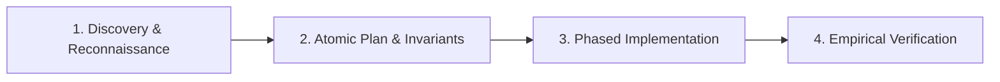

# Claude Code Best Practice — Agentic Engineering Framework

This skill provides the architectural principles, workflows, and operational rules from the canonical `shanraisshan/claude-code-best-practice` repository, moving AI pair programming from speculative "vibe coding" into disciplined **Agentic Engineering**.

---

## 1. Core Principles: Vibe Coding vs. Agentic Engineering

| Vibe Coding (Anti-Pattern) | Agentic Engineering (Best Practice) |
| :--- | :--- |
| Asking the agent to "make it work" with vague prompts | Supplying typed contracts, explicit invariants, and mathematical verification criteria |
| Allowing context to bloat with unstructured chat history | Decomposing into isolated subagents, single-responsibility phases, and progressive disclosure |
| Guessing file state or assuming past edits succeeded | **Ground before mutating**: Inspect targets, types, and existing callers before touching code |
| Accepting completion on assertion alone ("Done!") | **Evidence-backed completion**: Requiring real test execution outputs, zero warnings, and build validation |
| Stuffing giant text dumps into instructions | Keeping primary memory (`AGENTS.md` / `CLAUDE.md`) lean (< 300 lines) with modular skill references |

---

## 2. Memory Architecture & Instruction Hierarchy

To ensure the agent never suffers instruction degradation or ignores critical project constraints:

1. **System / Project Anchor (`AGENTS.md` / `CLAUDE.md`):**
   - High-density, immutable project identity, stack constraints, hard performance budgets, and core invariants.
   - Keep under 300 lines. Focus on non-negotiable boundaries, not temporary todo lists.
2. **Modular Rules (`.claude/rules/` or `.agents/rules/`):**
   - Scoped to specific file paths or domains (e.g., `tests/*.ts`, `src/mission/*.ts`, `public/ui/*`).
   - Auto-loaded only when the agent works in that scope, preserving token budget.
3. **Skills (`.agents/skills/<skill-name>/SKILL.md`):**
   - On-demand procedural playbooks and domain-specific tool documentation loaded via progressive disclosure.
   - Frontmatter defines precise `when_to_use` criteria and tool permissions.

---

## 3. Subagent Architecture & Context Isolation

When addressing complex or multi-layered tasks:
- **Do Not Pollute the Primary Context:** Exploration, large codebase scans, heavy file reads, and deep debugging must be delegated to dedicated subagents.
- **Single Responsibility:** Assign each subagent a sharp job description (e.g., `Mission Engine Verifier`, `HARD-SURFACE ECS Builder`, `E2E Playwright Auditor`).
- **Strict Return Contract:** Subagents must report back structured findings or verified patches, not raw conversational stream-of-consciousness.
- **Clean Workspace Modes:** Use `inherit` for shared state analysis, or `branch`/`share` when testing speculative or destructive refactors.

---

## 4. Multi-Step Orchestration Workflow

Follow the canonical 4-stage pipeline for non-trivial features:

1. **Reconnaissance:** Run targeted reads, check current test status, verify existing types and imports.
2. **Atomic Planning:** Break work into bounded waves. Define the exact acceptance criteria and verification command upfront.
3. **Phased Implementation:** Write or edit code incrementally. Preserve existing comments and docstrings. Check types immediately.
4. **Empirical Verification:** Execute automated suites (`npm test`, `npm run typecheck`, `npm run build`, E2E runtime). Never declare victory without observed command exit code 0.

---

## 5. Skills & Tool Integration Protocol

- **Progressive Disclosure:** Load detailed reference documents only when needed; avoid preloading large manuals into every turn.
- **Safe Execution Boundaries:** Never bypass permission checks, credentials, or sandboxes. Always execute documented, reproducible commands.
- **Idempotency:** When editing files, provide exact drop-in replacements. Avoid fragile substring searches that could match multiple blocks.

---

## 6. Bundled References & Deep Dives

The following official deep-dive references from `shanraisshan/claude-code-best-practice` are installed locally and available for inspection in `references/`:

- [`claude-subagents.md`](references/claude-subagents.md) — Comprehensive subagent lifecycle, tools restriction, and isolation guide.
- [`claude-commands.md`](references/claude-commands.md) — Custom slash command design, arguments handling, and workflow templates.
- [`claude-skills.md`](references/claude-skills.md) — Complete 20-field frontmatter specification, auto-discovery rules, and modular skill packaging.
- [`claude-memory.md`](references/claude-memory.md) — Multi-tier memory organization, auto-memory compaction, and path-scoped rules.
- [`claude-power-ups.md`](references/claude-power-ups.md) — Advanced productivity shortcuts and command combinators.
- [`claude-settings.md`](references/claude-settings.md) — Settings schema, sandboxing, and runtime configurations.
- [`claude-mcp.md`](references/claude-mcp.md) — MCP server orchestration, tools integration, and best practices.
- [`orchestration-workflow.md`](references/orchestration-workflow.md) — Full orchestrator-subagent team workflows and parallel task coordination.

