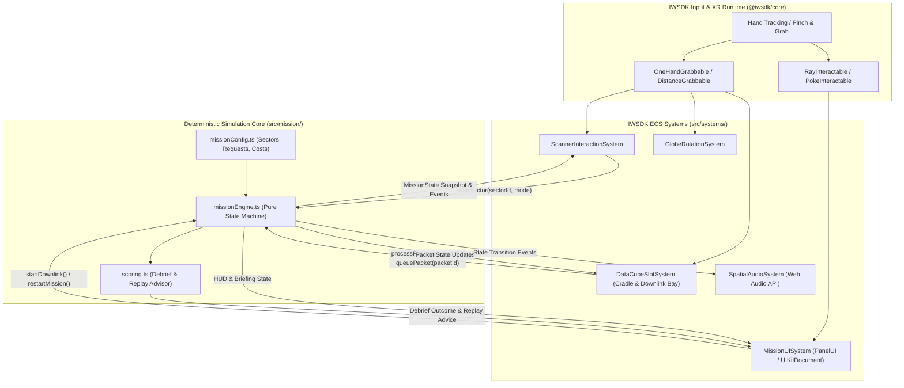

# ARCHITECTURE — ORBIT ZERO: THE LAST DOWNLINK

*Last updated: 2026-10-28*

## 1. High-Level Architectural Overview

**ORBIT ZERO: THE LAST DOWNLINK** uses a two-layer architecture designed specifically for **Meta Immersive Web SDK (`@iwsdk/core@1.1.0-rc.2`)**, deterministic testability, and low-overhead execution on both **Meta Quest Browser** and a **Dell Latitude 5490 (Intel i5-8350U, 8 GB RAM, Intel UHD 620)** development machine:

1. **Pure Simulation Core (`src/mission/`):** Zero dependencies on Three.js, WebXR, or DOM APIs. Implements a deterministic finite state machine (FSM), resource accounting (Power, Storage, Downlink Time), sensor observation resolution (Optical vs. Radar/SAR), onboard processing rules, downlink transmission queue evaluation, scoring, and replay recommendation generation. Fully unit-tested via **Vitest**.
2. **Spatial Presentation & XR Interaction Layer (`src/components/`, `src/systems/`, `src/scene/`, `ui/`):** Built on IWSDK's Elics-based Entity Component System (ECS), `super-three@0.185.0`, and `UIKitML` (`PanelUI`). Translates XR hand/pointer interactions into `MissionEngine` commands and reactively synchronizes 3D transforms, materials, shaders/indicators, spatial panels, and Web Audio cues with the simulation state.



---

## 2. Repository & Module Structure

Adapting the conceptual separation of concerns to the official `@iwsdk/core` + Vite + `UIKitML` project structure:

```text
d:\ORBIT-ZERO-THE-LAST-DOWNLINK\
├── AGENTS.md                        # Canonical coding agent instructions
├── package.json                     # Dependencies & scripts (dev, build, preview, test)
├── tsconfig.json                    # Strict TypeScript configuration
├── vite.config.ts                   # Vite + @iwsdk/vite-plugin-dev + @iwsdk/vite-plugin-uikitml
├── index.html                       # WebXR mount container (#scene-container)
├── docs/                            # Durable project memory & engineering specs
│   ├── PROJECT_CONTEXT.md
│   ├── IMPLEMENTATION_PLAN.md
│   ├── ARCHITECTURE.md
│   ├── DECISIONS.md
│   ├── RISK_REGISTER.md
│   ├── TESTING_AND_ACCEPTANCE.md
│   └── ART_DIRECTION.md
├── ui/                              # Source .uikitml spatial UI templates
│   ├── briefing-panel.uikitml       # 3 Emergency Request cards + Mission Start/Downlink trigger
│   ├── telemetry-hud.uikitml        # Power, Storage, Downlink Timer & Selected Cube Inspector
│   └── debrief-panel.uikitml        # Request outcomes, resource breakdown, Replay Advice & Restart
├── public/
│   ├── ui/                          # Compiled UIKit JSON emitted by @iwsdk/vite-plugin-uikitml
│   └── models/                      # Optional lightweight compressed .glb assets (< 2 MB total)
├── src/
│   ├── index.ts                     # Entry point: World.create, system registration, scene bootstrap
│   ├── mission/                     # PURE TYPESCRIPT SIMULATION CORE (No Three.js / WebXR imports)
│   │   ├── types.ts                 # MissionPhase, SectorId, SensorMode, ConfidenceLevel, DataPacket
│   │   ├── missionConfig.ts         # Deterministic Indus flood scenario, 6 sectors, 3 requests
│   │   ├── missionEngine.ts         # Pure state transitions: scan, process, discard, queue, transmit
│   │   └── scoring.ts               # Request evaluation, efficiency calculation, replay advisor
│   ├── components/                  # IWSDK ECS Components (createComponent)
│   │   ├── sectorNode.ts            # SectorId, cloudCover, waterState, highlightState
│   │   ├── scannerTool.ts           # Active SensorMode (Optical vs Radar), hover target, cooldown
│   │   ├── dataCube.ts              # PacketId, SensorMode, Confidence, StorageCost, TransmitSec, ProcessedFlag
│   │   └── snapSlot.ts              # SlotType (Tray, ProcessingCradle, DownlinkQueue, RecycleBin), OccupantId
│   ├── systems/                     # IWSDK ECS Systems (createSystem)
│   │   ├── missionBridgeSystem.ts   # Connects MissionEngine singleton to ECS world & dispatches events
│   │   ├── scannerSystem.ts         # Detects scanner-to-sector proximity/trigger & spawns Data Cubes
│   │   ├── slotInteractionSystem.ts # Magnetic snap-to-slot for Processing Cradle, Downlink Bay & Recycle
│   │   ├── downlinkClimaxSystem.ts  # Runs countdown timer, animates packet transmission & triggers Debrief
│   │   ├── panelUISystem.ts         # Binds UIKitDocument elements & click/poke handlers to MissionEngine
│   │   └── audioFeedbackSystem.ts   # Procedural Web Audio synthesizer for zero-latency spatial cues
│   └── scene/                       # Procedural + Low-Poly Three.js Mesh Builders
│       ├── orbitalConsole.ts        # Seated U-shaped ergonomic desk, cradle, downlink bay, status LEDs
│       ├── earthGlobe.ts            # Miniature 3D flood-basin globe with 6 interactive sector reliefs
│       ├── cubeSatModel.ts          # Stylized CubeSat chassis & articulated sensor head
│       └── dataCubeMesh.ts          # Tactile 3D data cube factory with confidence/mode visual glyphs
└── tests/
    ├── missionEngine.test.ts        # Unit tests for resource rules, cloud/radar physics, edge cases
    ├── scoring.test.ts              # Unit tests for request satisfaction & deterministic replay advice
    └── e2e/
        └── smoke.spec.ts            # Playwright headless GPU smoke test (--use-angle=d3d11)
```

---

## 3. Deterministic Simulation Model (`src/mission/`)

### 3.1 Resource & Cost Parameters (`missionConfig.ts`)
| Parameter | Value | Design Rationale |
| :--- | :--- | :--- |
| **Starting Power** | `55 Units` | Prevents scanning all 6 sectors with Radar (`6 * 14 = 84`). Forces strategic sensor selection and selective processing. |
| **Onboard Storage** | `9 Units` | Holds at most 3 raw observations (`3 * 3 = 9`) simultaneously unless the player processes (`1 Unit`) or discards irrelevant cubes. |
| **Optical Scan** | `8 Power`, `3 Storage`, `4.0s Tx` | Cheap energy cost; yields `Confirmed` in clear skies, but `Unverified` under dense cloud cover. |
| **Radar (SAR) Scan** | `14 Power`, `3 Storage`, `4.5s Tx` | Penetrates clouds; yields `Confirmed` on open water/floodplains, or `Probable` in complex urban/gorge geometry due to radar layover/speckle. |
| **Onboard Processing** | `6 Power` | Compresses a `Confirmed` or `Probable` raw cube from `3 Storage` → `1 Storage` and `4.0s/4.5s Tx` → `1.8s Tx`. **Rejected/No-op** on `Unverified` cloud-blocked cubes (cannot invent missing data). |
| **Downlink Window** | `10.0 Seconds` | Can only transmit ~2 raw packets (`8.0s - 9.0s`) OR up to 5 processed packets (`9.0s`), or 2 processed + 1 raw (`7.6s - 8.1s`). |

### 3.2 Six-Sector Deterministic Truth Table
| Sector | Terrain & Weather | Ground Truth | Optical Scan Result | Radar (SAR) Scan Result | Relevant Request |
| :--- | :--- | :--- | :--- | :--- | :--- |
| **Sector A** (*Indus Barrage North*) | Clear skies, upstream spillway | Normal flow (Not flooded) | `Confirmed` (Decoy / Normal) | `Confirmed` (Decoy / Normal) | None (Resource trap if scanned) |
| **Sector B** (*East Levee Highway*) | **Dense Cloud Cover**, lowland road | **Severely Flooded Access Road** | `Unverified` (Blocked by clouds) | **`Confirmed` (Specular water flood signature)** | **Request 1** (Requires `Confirmed` flooded access road) |
| **Sector C** (*Steel Truss Bridge*) | Clear skies, elevated river span | **Intact & Passable Crossing** | **`Confirmed` (Clear structural deck & dry approaches)** | `Probable` (Metal truss radar corner-reflection ambiguity) | **Request 2** (Requires `Confirmed` passable crossing) |
| **Sector D** (*Old Masonry Causeway*) | Light haze, low river crossing | Submerged / Impassable | `Confirmed` (Submerged causeway, not passable) | `Confirmed` (Submerged) | Distractor for Request 2 (proves D is unsafe, not the passable crossing) |
| **Sector E** (*Shelter Ridge Spur*) | **Heavy Storm Clouds**, narrow valley | **Landslide / Flash-Flood Hazard on Shelter Route** | `Unverified` (Blocked by clouds) | **`Probable` (Valley slope anomaly requiring ground verification)** | **Request 3** (Accepts `Probable` or `Confirmed` hazard verification alert) |
| **Sector F** (*Southern Retention Basin*) | Clear skies, agricultural plain | Controlled overflow | `Confirmed` (Non-critical farmland water) | `Confirmed` (Non-critical) | None (Resource trap) |

**Why this truth table works as a game puzzle:**
- A naive player who scans Sector B with Optical gets a cloud-blocked `Unverified` cube (wasting 8 Power and 3 Storage) and must discard it and re-scan Sector B with Radar (`14 Power`).
- A player who scans Sector C with Radar only gets `Probable` due to metal bridge corner reflection, whereas Optical on clear Sector C yields `Confirmed` for Request 2 at a lower energy cost (`8 Power`).
- To transmit answers for **all three requests** (Sector B Radar + Sector C Optical + Sector E Radar) within the `10.0s` Downlink Window (`4.5s + 4.0s + 4.5s = 13.0s > 10.0s`), the player **must** use the Onboard Processing Cradle on at least one or two packets (reducing `4.5s → 1.8s`, total `1.8s + 4.0s + 1.8s = 7.6s <= 10.0s`)!

---

## 4. Spatial Interaction & Ergonomic Architecture

### 4.1 Seated Console Layout ("Airplane Seat Test")
- Player rig (`world.player`): starts each session at `(0, 0, 0)` in the `local-floor` space. The cockpit is laid out for a head at the **design eye** `SEATED_EYE = (0, 1.25, 0.10)` (`src/ui/spatialLayout.ts`). On the first valid head pose, `updateSeatFit()` (`src/systems/missionControlSystem.ts`) shifts the rig by `seatFitOffset(head)` so the real head lands there; a standing judge (eye 1.7–1.9 m) is brought down, a low seat raised (limits x/z ±0.8 m, y −0.65…+0.45 m). Sitting down or standing up later (head 0.22 m off the design height for 3 s, nothing grabbed) refits the height. The RECENTER pad and the briefing button refit all three axes. See ADR-010.
- **Central Console Desk:** Positioned at `y = 0.78m`, `z = -0.50m`, curved in a `50°` arc so every slot is within `0.35m – 0.60m` reach of the user's resting hands.
- **Left Wing (`x = -0.32m, y = 0.85m, z = -0.45m`):** Scanner Dock (`Optical` / `Radar` mode toggle button + grabbable Scanner Tool) and **Raw Observation Tray** (3 magnetic slots).
- **Center Stage (`x = 0.0m, y = 0.92m, z = -0.48m`):** Rotatable **3D Earth Globe** (`r = 0.16m`, `OneHandGrabbable` with `rotate: true, translate: false`) and overhead **CubeSat Model** (`y = 1.32m, z = -0.55m`).
- **Right Wing (`x = +0.32m, y = 0.85m, z = -0.45m`):** **Onboard Processing Cradle** (1 slot + compress button), **Downlink Transmission Bay** (3 prioritized queue slots + "COMMIT DOWNLINK" button), and **Discard/Recycle Slot**.
- **World-Space UI Panels (`PanelUI`):**
  - Left angled panel (`x = -0.48m, y = 1.15m, z = -0.75m`): **Emergency Briefing & 3 Request Cards**.
  - Center-top angled panel (`x = 0.0m, y = 1.22m, z = -0.80m`): **Telemetry HUD (Power, Storage, Downlink Timer, Cube Inspector)**.
  - Right/Center modal panel (revealed on phase transition): **Mission Debrief & One-Pinch Replay**.

### 4.2 Forgiving Hands-First Interaction Mechanics
- **Grab & Pinch Configuration:** `features: { grabbing: { useHandPinchForGrab: true } }` in `World.create(...)`. Supports both direct hand pinch/grab (`OneHandGrabbable`) and short-range telekinetic grab (`DistanceGrabbable` with `MovementMode.MoveTowardsTarget`) so seated users never strain to reach.
- **Magnetic Snap Zones (`slotInteractionSystem.ts`):** When a released Data Cube is within `0.12m` of a valid slot (Raw Tray, Processing Cradle, Downlink Bay, or Recycle Bin), it smoothly lerps into the slot transform and plays a tactile lock click. If dropped in mid-air outside any slot, it automatically returns to its last valid tray slot (`returnToOrigin` recovery) — **zero lost cubes on the floor**.

---

## 5. Asset & Audio Pipeline (Hardware-Conscious)

Because the development machine is a **Dell Latitude 5490 (Intel UHD 620, 8 GB RAM)**, running heavy Blender bakes or loading multi-megabyte 4K textures would degrade both development iteration and Quest framerate:
1. **Procedural + Modular Low-Poly Geometry (`src/scene/`):** The orbital console, CubeSat chassis (gold Kapton foil, dark solar wings, optical/SAR aperture), 6-sector relief globe, and tactile data cubes are constructed from clean, batched Three.js geometries (`BufferGeometryUtils.mergeGeometries` and `InstancedMesh`) using < 15 materials total and `< 50` draw calls.
2. **Procedural Canvas Textures & UIKitML:** Sector surface details (rivers, levees, cloud layers, SAR radar scanlines) and data cube badges are generated deterministically via lightweight offscreen 2D canvases (`512x512` max) and `UIKitML` vector panels—requiring **zero external CDN calls** (avoiding Quest CORS issues) and `< 15 MB` total GPU texture memory.
3. **Procedural Web Audio Synthesizer (`src/systems/audioFeedbackSystem.ts`):** All sound effects (briefing alert chime, optical shutter click, radar pulse sweep, data cube snap click, processing harmonic hum, downlink packet transmission bursts, and debrief chord) are synthesized at runtime via the browser's native `AudioContext` + `PannerNode` (3D spatialized audio). This guarantees zero audio file loading failures, tiny bundle size, and crisp spatial feedback.

---

## 6. Build, Verification & Deployment Flow

1. **Unit Verification:** `npm test` runs **Vitest** against `src/mission/*.ts` in `< 2 seconds` with zero GPU overhead.
2. **Type & Build Check:** `npm run build` runs `tsc --noEmit` + `vite build` (including `@iwsdk/vite-plugin-uikitml` compilation).
3. **Desktop & Emulator Validation:** `npm run dev` starts Vite with HTTPS (`@vitejs/plugin-basic-ssl` / `mkcert`) and `@iwsdk/vite-plugin-dev` (`@iwer/devui`), enabling full mouse/keyboard hand-emulation testing in Chrome/Edge.
4. **Automated Headless GPU Smoke Test:** Playwright script launches Chromium with `--use-angle=d3d11` and `--ignore-certificate-errors`, verifies WebGL2 hardware adapter (not SwiftShader), confirms `World.create` resolves without console errors, and checks `world.renderer.info.render.calls < 80`.
5. **Production Hosting for Judges:** Static `dist/` bundle deployed to **GitHub Pages** (or **Vercel**) over HTTPS. Judges open the URL directly in Meta Quest Browser and tap **Enter VR**.
