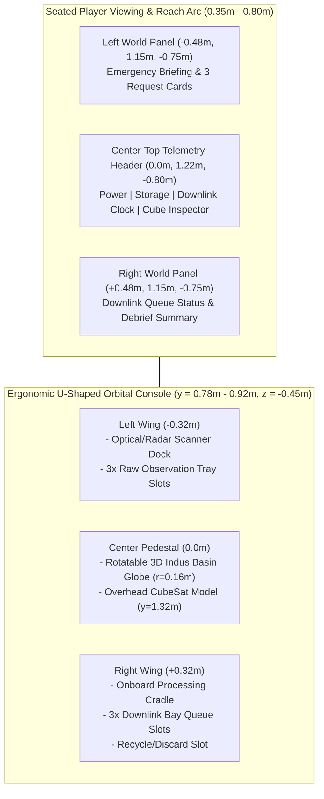

# VR ART DIRECTION — ORBIT ZERO: THE LAST DOWNLINK

*Last updated: 2026-10-28*

## 1. Visual Identity & Core Aesthetic
**Aesthetic Direction:** **"Tactile Orbital Instrumentation"** (inspired by NASA/ESA CubeSat cleanroom hardware, JPL mission-ops telemetry consoles, and physical aviation switchgear).

This is an **immersive 3D spatial workspace**, not a flat web dashboard floating in space. Every gameplay state—power drain, cloud obstruction, SAR radar backscatter, packet size compression, and downlink transmission—is represented through **physical 3D form, material response, spatial light, and directional audio**.

### Anti-Patterns Strictly Banned
- No generic SaaS glassmorphism cards with blurry backdrops that tank fill-rate on mobile VR GPUs.
- No rainbow gradients, neon cyberpunk clutter, or decorative particle storms.
- No tiny `< 14px` text panels or long scrolling paragraphs in VR.
- No heavy post-processing (`UnrealBloomPass`, SSAO, depth-of-field) that breaks stereo comfort or drops Quest Browser below 72 FPS.

---

## 2. Color Palette & Semantic Tokens

Designed for high contrast in VR optics (`>= 7:1` for primary telemetry, `>= 4.5:1` minimum for secondary labels) and color-vision accessibility (every semantic color is paired with a geometric icon and text label):

| Token Role | Hex Code | Linear/Three.js Usage | Semantic Meaning & Dual-Coding |
| :--- | :---: | :--- | :--- |
| **Deep Orbital Navy** | `#070B14` | Scene background & console bay recess | Quiet dark background that prevents VR lens glare / god-rays |
| **Chassis Slate** | `#161F30` | Console deck body (`MeshStandardMaterial`, roughness `0.65`, metalness `0.35`) | Primary physical hardware surface |
| **Instrument Bezel** | `#26354D` | Slot rims, tactile frame borders, inactive buttons | Structural boundaries and grab zones |
| **Telemetry Off-White** | `#F1F5F9` | Primary world-space typography & high-priority icons | Maximum legibility at `0.5m – 0.85m` viewing distance |
| **Muted Steel** | `#94A3B8` | Secondary unit labels (`PWR`, `STR`, `SEC`) | De-emphasized structural labels |
| **Instrument Cyan** | `#00E5FF` | Active scanner beam (Optical), hover rings, downlink stream | Primary interactive affordance & **Optical Sensor** signature |
| **SAR Radar Violet/Teal** | `#38BDF8` / `#818CF8` | Radar pulse grid, wireframe scan rings | **Radar (SAR) Sensor** signature (distinct pattern + label `SAR`) |
| **Kapton Gold / Amber** | `#F59E0B` | CubeSat thermal foil, Power meter, **`Probable` `[?]`** status | Caution / Resource expenditure / **`Probable` `[?]`** evidence |
| **Verified Emerald** | `#10B981` | **`Confirmed` `[✓]`** badge, locked downlink slot, satisfied request | High-confidence verified intelligence **`[✓] CONFIRMED`** |
| **Hazard Coral / Red** | `#EF4444` | **`Unverified` `[✕]`** cloud-blocked status, downlink window `< 3s` alert | Blocked observation **`[✕] UNVERIFIED`** / Critical alert |

---

## 3. 3D Scene Layout & Object Specifications

### 3.1 The Miniature 3D Earth / Flood Basin Globe (`src/scene/earthGlobe.ts`)
- **Scale & Placement:** Radius `0.16m` (`32cm` diameter), mounted on a gimbal pedestal at `(0, 0.92m, -0.48m)`—directly in front of the player's hands for effortless one-hand rotation (`OneHandGrabbable` with `rotate: true, translate: false`).
- **Visual Readability:** Stylized low-poly relief sphere showcasing the Indus River basin, flood levees, tributaries, and **six clearly demarcated hexagonal/sectored terrain zones (`A` through `F`)**:
  - Raised 3D sector pins with high-contrast letter badges (`A`–`F`).
  - Semi-transparent raised cloud-deck meshes hovering over **Sector B** and **Sector E** so the player can visually see cloud obstruction before scanning!
  - Distinct miniature 3D landmarks on key sectors (barrage wall on `A`, flooded highway embankment on `B`, steel truss bridge on `C`, submerged causeway on `D`, mountain shelter spur on `E`, retention basin on `F`).

### 3.2 The CubeSat Model (`src/scene/cubeSatModel.ts`)
- **Scale & Placement:** Compact 3U CubeSat (`0.12m × 0.12m × 0.30m` body with deployed `0.45m` solar wings) suspended above the globe at `(0, 1.32m, -0.55m)`.
- **Silhouette & Materials:** Metallic dark-blue solar cell panels (`metalness: 0.7, roughness: 0.25`), crinkled gold Kapton foil accents (`#F59E0B`), optical camera baffle, and foldable SAR radar planar antenna that tilts toward the globe during scans and pulses toward the ground station during downlink.

### 3.3 Tangible 3D Data Cubes (`src/scene/dataCubeMesh.ts`)
- **Raw Observation Cube (`0.065m` chamfered cube):**
  - Color-coded core rim (`Cyan` for Optical, `Indigo/Teal` for SAR Radar).
  - High-contrast top & front face canvas texture showing: Sector ID (`SEC-B`), Sensor Mode (`OPT` / `SAR`), Confidence Badge (`[✓] CONFIRMED` / `[?] PROBABLE` / `[✕] UNVERIFIED`), Storage bars (`3 STR`), and Downlink Time (`4.5s`).
- **Processed Report Cube (`0.050m` compact wafer/prism):**
  - Visually slimmer and denser after emerging from the Onboard Processing Cradle, displaying `1 STR` and `1.8s` with a bright gold/emerald data-bus stripe—making the bandwidth savings physically obvious in the player's hand.

---

## 4. Lighting, Materials & Typography

### 4.1 Restrained Lighting Setup
- **Color Management:** `THREE.ColorManagement.enabled = true`, `SRGBColorSpace`, `ACESFilmicToneMapping` (`exposure: 1.0`).
- **Lights (Max 3 total):**
  1. `HemisphereLight(0xdbeafe, 0x0f172a, 0.8)` for soft ambient fill across the console and globe.
  2. `DirectionalLight(0xffffff, 1.4)` (orbital sunlight grazing the CubeSat and Earth relief, **no dynamic shadow map** or single static `512x512` shadow map only if GPU budget permits).
  3. One dynamic `PointLight` (or emissive material pulse) during active scanning/downlink climax.
- **Material Discipline (per `ui-ux-pro-max` Three.js guidelines):**
  - Use `MeshStandardMaterial` **only** on physical 3D objects (console deck, globe, CubeSat, data cubes).
  - Use `MeshBasicMaterial` on all unlit UI indicators, scan rings, trajectory lines, and HUD badges to save fragment shader cost.

### 4.2 World-Space Typography (`UIKitML` / `PanelUI`)
- **Font Hierarchy:** Clean geometric sans-serif (`Inter` / default UIKit SDF font) with high-contrast weight (`600–700` for headers and numbers).
- **Minimum Viewing Sizes (at `0.6m – 0.8m` distance):**
  - Panel Titles & Countdown Clock: `3.2 – 4.5` UIKit units (`~28–36pt` equivalent).
  - Request Cards & Status Labels: `2.0 – 2.6` UIKit units (`~18–22pt` equivalent).
  - Never place more than **25 words** on any single card. Use icon + short phrase (`"REQ 1: Flooded Road — Need [✓] CONFIRMED"`).

---

## 5. Animation & Spatial Audio Direction

### 5.1 Purposeful State Animations
1. **Hover & Grab Feedback:** Hovering a hand/ray over the globe, scanner, or data cube scales the highlight ring (`1.0 → 1.08` over `120ms`) and illuminates the target slot rim.
2. **Scanning Sweep:** Holding the scanner over a sector projects a conical beam (steady cyan spotlight for Optical; pulsing wireframe rings for Radar) for `0.6s`, culminating in a crisp spawn-and-arc animation placing the new Data Cube into the Raw Tray.
3. **Processing Compression:** Dropping a cube into the Processing Cradle triggers a `0.5s` mechanical clamp animation and energetic cyan-to-gold pulse, visibly compacting the mesh size (`0.065m → 0.050m`).
4. **The Downlink Climax:** Opening the downlink window shifts the console perimeter LEDs to pulsing amber, starts the spatial countdown clock, and fires ascending light-packets from each queued Data Cube up through the CubeSat antenna as each packet completes transmission.

### 5.2 Procedural Spatial Audio Palette (`src/systems/audioFeedbackSystem.ts`)
Synthesized via Web Audio API (`AudioContext` + `OscillatorNode` / filtered noise + `PannerNode` positioned at the 3D interaction source):
- **Briefing Chime:** Two-tone rising fifth (`440Hz → 660Hz`, sine/triangle) at mission start.
- **Optical Scan:** Crisp camera shutter click + high crystalline ping (`1200Hz`).
- **Radar (SAR) Scan:** Low-mid frequency modulated sonar/radar sweep (`220Hz → 480Hz → 220Hz`).
- **Unverified / Blocked Alert:** Dull double low-buzz (`160Hz` square/triangle, low-pass filtered) when clouds block an optical scan.
- **Magnetic Slot Lock:** Short tactile mechanical click (`80ms` filtered impulse) on cube snap.
- **Processing Complete:** Harmonic compression chord (`523Hz + 659Hz + 784Hz`).
- **Downlink Countdown & Packet Sent:** Per-second soft telemetry tick (`880Hz`), ascending telemetry burst as each packet reaches 100%, and a decisive window-closed latch sound at `0.0s`.

---

## 6. Strict Performance & Memory Budget

| Metric | Hard Ceiling (Quest Browser) | Target Budget (ORBIT ZERO MVP) |
| :--- | :---: | :---: |
| **Frame Rate** | `>= 60 FPS` (Devpost rule) | **`72 FPS`** (`13.9ms` frame budget on Quest) / **`60 FPS`** on UHD 620 |
| **Draw Calls** | `< 100` | **`< 50` draw calls** |
| **Triangle Count** | `< 750,000` per eye | **`< 35,000` triangles total** |
| **Texture Memory** | `< 256 MB` | **`< 16 MB`** (Procedural `512x512` canvases + UIKit SDFs) |
| **Dynamic Lights** | `<= 3` | **`2` static/hemisphere + `1` point light** (zero dynamic shadow maps) |
| **Render-Loop Allocations** | `0` per frame | Pre-allocate all `THREE.Vector3`, `Quaternion`, and `Matrix4` temporaries |
| **Total Production Bundle** | `< 15 MB` | **`< 3 MB` gzipped** |
