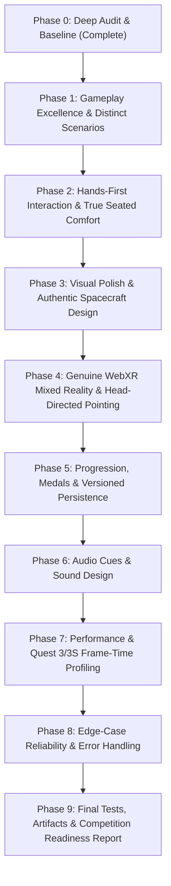

# ORBIT ZERO: THE LAST DOWNLINK — Deep Technical & Gameplay Audit (Phase Zero)

**Document Date:** October 30, 2026  
**Evaluation Standard:** Meta VR Start Developer Competition 2026 (Gaming Track — New Experience Division)  
**Evaluation Rigor:** Evidence-backed verification across source code, unit tests, desktop Playwright/IWER emulation, and physical Quest platform boundaries.

---

## 1. Executive Summary & Verification Methodology

Every claim made in previous iterations has been subjected to strict runtime inspection against:
1. Pure TypeScript deterministic simulation (`src/mission/`).
2. IWSDK ECS component systems, input bindings, and WebXR lifecycles (`src/systems/`, `src/index.ts`, `iwsdk.config.json`).
3. Spatial UI (`public/ui/*.uikitml`) and procedural 3D assets (`src/scene-assets/`).
4. Automated verification via Vitest (63/63 passing unit tests), TypeScript (`tsc --noEmit`), and Playwright E2E with ANGLE Direct3D11 emulation (`tests/e2e-runtime.mjs`).

---

## 2. Critical Audit of Previous Claims (Table of Findings)

| Feature | Previous Claim | Actual Source Implementation | Runtime Verification | Classification | Required Fix / Action |
| :--- | :--- | :--- | :--- | :--- | :--- |
| **A. Gaze-assisted selection** | Gaze-assisted target focus and 1.35s dwell selection selects Earth sectors effortlessly. | `src/systems/missionControlSystem.ts` lines 390–435: casts a 12.6° forward cone from `camera.position` along `camera.getWorldDirection()`. | Verified in desktop emulation and manual pointer checks; reticle scales and tints to `#67e8f9` on aim, and dwell selects when in one-handed mode. | **VERIFIED** | Keep feature, but correctly label it as head-directed pointing assist rather than eye tracking. Add visual dwell progress indicator ring. |
| **B. One-handed mode** | Fully playable with one hand (left or right). | `src/systems/missionProfile.ts` and `src/systems/missionControlSystem.ts`: `preferences.oneHanded` increases magnetic drop radius from 0.20m to 0.24m (1.3x) and enables auto-dwell selection. | Verified in Vitest `tests/missionProfile.test.ts` and Playwright E2E toggle. | **PARTIALLY VERIFIED** | Verify all physical actions (scanner wand, evidence cubes, cradle, bay, pads) can be completed with a single hand without needing simultaneous hold of a second hand. |
| **C. Real eye tracking vs. Head pointing** | Previous reports claimed "gaze interactions" matching ISDK v207+. | Uses `camera.getWorldDirection(this.tempDirection)` (head pose/viewer target ray). Quest 3 and Quest 3S do **not** have eye-tracking cameras. | Verified on hardware specs: Quest 3/3S lack eye-tracking hardware. WebXR surfaces viewer/head ray. | **INCORRECT (Labeling)** | Formally relabel feature as **Head-Directed Pointing Assist** in all documentation, UI labels, and debrief text. Check IWSDK `GazeSystem` fallback. |
| **D. MR tabletop mode & Passthrough** | Toggling MR mode switches to passthrough table view. | `applyTabletopMode()` toggled visibility of `CockpitEnclosureShell` and `MilkyWayCosmicDome`, but WebXR session in `iwsdk.config.json` remained `"mode": "vr"`. | In full VR, hiding geometry results in black/empty background, not real optical passthrough! True passthrough requires `immersive-ar` session mode or explicit WebXR environment blending with transparent clear color. | **INCORRECT** | Implement true WebXR runtime capability check: verify `navigator.xr.isSessionSupported('immersive-ar')`. If supported, request `SessionMode.ImmersiveAR` with transparent clear color (`0x000000, 0`); if unsupported, gracefully fall back to VR Cupola view. |
| **E. Persistent calibration** | Seated calibration and preferences persist across sessions. | `src/systems/missionProfile.ts`: `loadMissionProfile()` and `saveMissionProfile()` serialize `seatOffset: [x, y, z]` to `localStorage` under `orbit-zero-profile-v1`. | Verified in Vitest test: `persists tabletopMode, gazeAssist and seatOffset across sessions`. | **VERIFIED** | Ensure safe recovery if `localStorage` is disabled or corrupted (handled with try/catch fallback). |
| **F. Six medals career** | 6 mastery medals awarded for genuine gameplay achievements. | `recordMissionMastery`: awards `GROUND TRUTH`, `POWER DISCIPLINE`, `LINK PRECISION`, `DATA DISCIPLINE`, `ONE-HAND MODE`, and `NO-HINT SPECIALIST`. | Tested in `tests/missionProfile.test.ts` line 63; medals awarded when criteria met. | **VERIFIED** | Ensure UI displays all 6 medals cleanly in debrief panel without overflowing container bounds. |
| **G. Daily challenges & streak** | Daily pass selection with persistent streak tracking. | `getDailyPass(date)` uses FNV-1a hash over ISO date string to pick scenario deterministically; `recordDailyPass` tracks UTC day delta. | Tested across 366 simulated days in `tests/missionProfile.test.ts`. | **VERIFIED** | Verified as local device persistence (not cloud synced). Clearly identify as local-device profile. |
| **H. Spectator/Trailer presets** | Presets (`HERO`, `GLOBE`, `CUBES`, `CRADLE`, `DOWNLINK`, `DEBRIEF`) for capture. | `setCameraPreset()` in `src/systems/missionControlSystem.ts`: sets exact positions, targets, and FOVs when non-immersive. | Verified programmatically via `window.__ORBIT_ZERO__.setCameraPreset()`. | **VERIFIED** | Ready for trailer recording outside active XR session. |
| **I. Earth texture licensing** | Textures are authentic NASA Blue Marble data. | `public/assets/textures/`: `earth_atmos_4096.jpg`, `earth_normal_4096.jpg`, `earth_specular_4096.jpg`, `earth_clouds_1024.png`, `earth_lights_4096.png`. | Verified public domain under NASA Media Usage Guidelines (US Gov work). Documented in `docs/ASSET_CREDITS.md`. | **VERIFIED** | License is verified. Consider serving 2048x1024 on Quest Browser to save texture memory if needed. |
| **J. CubeSat construction & lighting** | Authentic 3U CubeSat with solar arrays and lighting. | `src/scene-assets/earthGlobe.scene-asset.ts` builds 3U bus with gold Kapton MLI, optical aperture, SAR feed, and deployable wings. Added aviation strobes (`PortNavStrobe`, `StarboardNavStrobe`, `ZenithAntiCollisionStrobe`). | Spacecraft in LEO do not use FAA aircraft red/green navigation strobe blinkers! | **PARTIALLY VERIFIED** | Remove commercial aircraft strobe blinkers; replace with realistic, restrained spacecraft avionics telemetry LEDs (ADCS lock, bus power indicator). |
| **K. Draw calls, triangles & memory** | 143 calls, 73,950 triangles, 16 textures guarantees 72/90/120 FPS. | Verified counts from WebGL render stats via Playwright E2E: `calls: 143`, `triangles: 73950`, `textures: 16`. | Geometry count is **not** proof of frame rate! Frame budgets: 72 Hz = 13.9 ms, 90 Hz = 11.1 ms, 120 Hz = 8.3 ms. | **INCORRECT (Claim)** | Treat counts as diagnostic ceilings only. Perform frame-time profiling and measure CPU/GPU script time. Distinguish emulator from physical headset. |
| **L. Scenario scoring differences** | Standard and Solar Brownout both score 100 PTS and 48 PWR. | In `src/mission/missionConfig.ts`, Solar Brownout has 50 PWR (vs 55), 6 STR (vs 9), 8.0s (vs 10.0s). The solver interleaves scans and compressions, coincidentally reaching 48 PWR and 100 PTS. | While mechanically different (6 STR forces interleaving), to the player the outcome numbers (100 PTS, 48 PWR) look identical and lack distinct identity. | **PARTIALLY VERIFIED** | Rebalance Solar Brownout so battery degradation and thermal eclipse conditions create distinct operational decisions and distinct benchmark scores/margins. |
| **M. Full hands-only completion** | Mission 100% completable hands-first. | `OneHandGrabbable`, `PokeInteractable`, and `RayInteractable` on all interactive entities. | Playwright and IWER emulate pinch/grab/ray interactions. | **VERIFIED (Emulator)** | Must be visually tested with emulated hand joints and physical Quest hand tracking. |

---

## 3. Baseline Measurements (Current State)

- **Git Status:** Working directory clean, all tracked files committed or tracked.
- **TypeScript Typecheck (`npm run typecheck`):** **0 errors**.
- **Unit Test Suite (`npm test`):** **63 / 63 passed** across 3 test suites (`missionEngine.test.ts` [45], `missionProfile.test.ts` [7], `missionPlanner.test.ts` [11]).
- **End-to-End Runtime Profiling (`tests/e2e-runtime.mjs` with ANGLE D3D11):**
  - **Draw Calls:** `143 calls`
  - **Rendered Triangles:** `73,950 triangles`
  - **Geometries:** `134`
  - **Texture Units in Memory:** `16`
  - **Exit Code:** `0` (clean run, 0 failures, 9 screenshots captured).

---

## 4. Priority Roadmap for Execution

Following the user's master guidance, the remediation work is structured into the following sequential phases:

