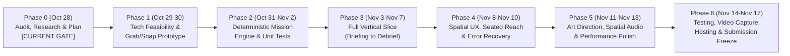

# PHASED IMPLEMENTATION PLAN — ORBIT ZERO: THE LAST DOWNLINK

*Last updated: 2026-10-28*

## Implementation Status Summary (Verified 2026-10-28)
- **Phase 0 (Audit, Skills, Documentation & Git Hygiene):** **COMPLETED & VERIFIED**
- **Milestone A / Phase 1 (IWSDK 1.0.1 Stable Scaffold, Build & Hardware ANGLE Smoke):** **COMPLETED & VERIFIED** (`npm run typecheck`, `npm run build`, `npm run test:e2e`)
- **Milestone C / Phase 2 (Deterministic Mission Engine, 6-Sector Science Rules & Vitest Suite):** **COMPLETED & VERIFIED** (`npm test` — 7/7 tests passing in `tests/missionEngine.test.ts`)
- **Milestone B, D, E / Phase 3–5 (3D Orbital Console, Relief Globe, Grabbable Scanner & Cubes, 3 UIKitML Spatial Panels, Procedural Web Audio & Full Playable Loop):** **COMPLETED & VERIFIED** (`artifacts/ui-runtime-review.jpg`, `npm run test:e2e`)
- **Milestone F / Phase 6 (Final Physical Quest Headset Testing, Public HTTPS Hosting & `< 3:00` Video Capture):** **READY FOR USER HEADSET / DEPLOYMENT STEP**
- **Current Date:** October 28, 2026
- **Hard Competition Deadline:** November 18, 2026 @ 12:00 PM PST (**November 19, 2026 @ 01:00 AM PKT / GMT+5**)
- **Internal Feature Freeze:** **November 14, 2026**
- **Target Submission Date:** **November 17, 2026** (48-hour safety buffer before hard deadline)
- **Development Hardware:** Dell Latitude 5490 (Intel i5-8350U, 8 GB RAM, Intel UHD 620, Windows, 42.9 GB free on `D:`)
- **Physical Headset Access:** Unconfirmed (Emulator-first development path using `@iwer/devui` + Playwright `--use-angle=d3d11`, with optional on-device Quest testing window reserved for Nov 12–14).

---

## Phase 0 — Repository, Requirements, Skill & Architecture Audit
- **Target Dates:** October 28, 2026 (Completed in this session)
- **Objective:** Inspect workspace and source documents (`devpost.txt`, `core_concept`), verify competition rules and hardware limits, audit installed skills, install Meta's official `hz-iwsdk-webxr` skill, configure `.gitignore` hygiene, and establish durable project context in `AGENTS.md` and `docs/*.md`.
- **Deliverables:**
  - Installed `.agents/skills/hz-iwsdk-webxr` skill from `meta-quest/agentic-tools`.
  - Canonical [`AGENTS.md`](../AGENTS.md) and 7 durable documentation files in `docs/`.
  - Surgical [`.gitignore`](../.gitignore) protecting personal notes (`devpost.txt`, `core_concept`) and local skill/GSD installer artifacts while tracking project documentation and future source code.
- **Validation Commands:**
  - `powershell -ExecutionPolicy Bypass -File scripts/validate-all.ps1`
  - `git status --short`
  - `git check-ignore -v devpost.txt core_concept skills-lock.json .agents/skills/hz-iwsdk-webxr`
- **Exit Condition (Approval Gate):** User reviews and approves the Phase 0 audit and implementation plan before Phase 1 code scaffolding begins.

---

## Phase 1 — Technical Proof of Feasibility (First Milestone)
- **Target Dates:** October 29 – October 30, 2026 (~2 days / 1 AI execution session)
- **Dependencies:** User approval of Phase 0 plan.
- **Objective:** Prove the approved stack (`@iwsdk/core@1.1.0-rc.2` + `three@npm:super-three@0.185.0` + TypeScript + Vite + `@iwsdk/vite-plugin-dev` + `@iwer/devui` + Vitest) builds and runs cleanly on the Dell Latitude 5490, enters XR emulation, and supports grabbing a 3D Data Cube and snapping it into a console slot.
- **Tasks:**
  1. **Task 1.1 (Scaffold & Config):** Initialize `package.json`, `tsconfig.json`, `vite.config.ts`, `vitest.config.ts`, and `index.html` using pinned `@iwsdk/core@1.1.0-rc.2`, `three@npm:super-three@0.185.0`, `@iwsdk/vite-plugin-dev@1.1.0-rc.2`, and `@iwsdk/vite-plugin-uikitml@0.4.2`.
  2. **Task 1.2 (Minimal XR Scene & Grab/Snap Prototype):** Create `src/index.ts`, `src/components/snapSlot.ts`, and `src/systems/slotInteractionSystem.ts` with `World.create(...)`, a seated console surface, one rotatable test globe sphere, one grabbable test Data Cube (`OneHandGrabbable` + `DistanceGrabbable` with `useHandPinchForGrab: true`), and two magnetic snap slots (Raw Tray + Downlink Slot) with `returnToOrigin` drop recovery.
  3. **Task 1.3 (Automated Smoke & GPU Verification):** Create `tests/e2e/smoke.spec.ts` launching Playwright Chromium with `--use-angle=d3d11` and `--ignore-certificate-errors` to verify WebGL2 hardware rendering on Intel UHD 620, zero console errors, and draw calls `< 50`.
- **Deliverables:** Working IWSDK project scaffold, grab-and-snap prototype, passing build, and passing Playwright GPU smoke test.
- **Validation Commands:**
  - `npm run build`
  - `npm test`
  - `npx playwright test tests/e2e/smoke.spec.ts`
- **Risks & Fallbacks:**
  - *Risk:* `@iwsdk/vite-plugin-uikitml` or `@babylonjs/havok` WASM path issue in Vite build.
  - *Fallback:* Configure Vite `optimizeDeps` / static asset serving or use lightweight analytical distance-snap in `slotInteractionSystem.ts` without booting the Havok worker.
- **Acceptance Criteria & Exit Gate:**
  - `npm run build` succeeds with zero TypeScript or bundler errors.
  - Headless GPU test confirms `Intel(R) UHD Graphics 620` adapter (not SwiftShader), `window.__ORBIT_ZERO_READY__ === true`, and `render.calls < 50`.
  - User or emulator test confirms a cube can be grabbed, moved, and snapped into a slot.

---

## Phase 2 — Deterministic Mission Engine & Scientific Rules (TDD)
- **Target Dates:** October 31 – November 2, 2026 (~3 days / 1–2 AI execution sessions)
- **Dependencies:** Phase 1 complete.
- **Objective:** Build and unit-test the complete, deterministic pure-TypeScript simulation engine (`src/mission/`) with zero 3D dependencies using Test-Driven Development (TDD).
- **Tasks:**
  1. **Task 2.1 (Domain Types & Scenario Truth Table):** Create `src/mission/types.ts` and `src/mission/missionConfig.ts` defining the 6 Indus Basin sectors (`A`–`F`), 3 ground emergency requests, Optical (`8 PWR`) vs. Radar/SAR (`14 PWR`) outcomes, cloud obstruction rules, storage limits (`9 STR`), processing parameters (`6 PWR`, `3→1 STR`, `4.5s→1.8s Tx`), and `10.0s` downlink window.
  2. **Task 2.2 (Mission State Machine):** Implement `src/mission/missionEngine.ts` supporting `startMission()`, `scanSector(sectorId, mode)`, `processPacket(packetId)`, `discardPacket(packetId)`, `queueForDownlink(packetId, slotIndex)`, `removeFromDownlink(packetId)`, `executeDownlink()`, and `reset()`.
  3. **Task 2.3 (Deterministic Scoring & Replay Advisor + Unit Tests):** Implement `src/mission/scoring.ts` and comprehensive unit tests in `tests/missionEngine.test.ts` and `tests/scoring.test.ts` proving all resource invariants, cloud/radar trade-offs, and replay recommendations.
- **Deliverables:** Pure TypeScript simulation package (`src/mission/`) + 100% passing Vitest suite.
- **Validation Commands:**
  - `npm test`
  - `npx tsc --noEmit`
- **Acceptance Criteria & Exit Gate:**
  - All unit tests pass (`>= 25` deterministic test assertions covering power exhaustion, storage overflow, cloud-blocked optical scans, radar bridge ambiguity, unverified processing rejection, downlink cutoff at `10.0s`, and replay advice).
  - Zero imports of `three` or `@iwsdk/core` inside `src/mission/`.

---

## Phase 3 — Full Vertical Slice (Briefing → Scan → Process → Downlink → Debrief)
- **Target Dates:** November 3 – November 7, 2026 (~5 days / 2–3 AI execution sessions)
- **Dependencies:** Phase 1 and Phase 2 complete.
- **Objective:** Connect `src/mission/` to the 3D IWSDK scene and spatial UI so a player can complete the entire mission from start to debrief and restart using hands-first interactions.
- **Tasks:**
  1. **Task 3.1 (6-Sector 3D Globe & Scanner Tool System):** Build `src/scene/earthGlobe.ts` (rotatable globe with 6 clickable/scannable sector reliefs `A`–`F` and cloud meshes over `B` and `E`), `src/components/scannerTool.ts`, and `src/systems/scannerSystem.ts` (mode toggle `OPTICAL`/`RADAR`, proximity scan trigger, and spawning tangible Data Cubes into the Raw Tray).
  2. **Task 3.2 (Tangible Data Cubes, Processing Cradle & Downlink Bay):** Build `src/scene/dataCubeMesh.ts` (dynamic canvas badges showing Sector, Mode, `[✓]`/`[?]`/`[✕]` Confidence, Storage, and Tx Time) and wire `slotInteractionSystem.ts` + `downlinkClimaxSystem.ts` so placing cubes into the Processing Cradle or Downlink Queue invokes `MissionEngine` methods and runs the `10.0s` transmission countdown.
  3. **Task 3.3 (World-Space Panels — Briefing, Telemetry HUD & Debrief):** Create `.uikitml` panels (`ui/briefing-panel.uikitml`, `ui/telemetry-hud.uikitml`, `ui/debrief-panel.uikitml`) and `src/systems/panelUISystem.ts` displaying the 3 ground requests, live Power/Storage/Timer meters, selected cube inspector, final consequence debrief, replay recommendation, and one-pinch **Restart Mission** button.
- **Deliverables:** End-to-end playable vertical slice in WebXR.
- **Validation Commands:**
  - `npm test`
  - `npm run build`
  - `npx playwright test` (verifying full mission state progression from Briefing → Scanning → Processing → Downlink → Debrief → Restart).
- **Acceptance Criteria & Exit Gate:**
  - Complete mission loop is playable end-to-end without console errors.
  - Untransmitted cubes do not count toward request completion.
  - Restart button cleanly resets all 3D entities, slots, and `MissionEngine` state for immediate replay.

---

## Phase 4 — Spatial UX, Seated Ergonomics & Error Recovery Refinement
- **Target Dates:** November 8 – November 10, 2026 (~3 days / 1–2 AI execution sessions)
- **Dependencies:** Phase 3 complete.
- **Objective:** Tune every spatial interaction for seated comfort ("airplane seat test"), forgiving grab/pinch tolerances, instant visual onboarding ("first five minutes"), and foolproof recovery from missed grabs.
- **Tasks:**
  1. **Task 4.1 (Seated Reach & Affordance Tuning):** Verify and adjust all console slot coordinates (`0.35m – 0.60m` radius), add magnetic slot-preview ghost wireframes when holding a cube or scanner, and add redundant pokeable 3D buttons (`PokeInteractable` + `RayInteractable`) for globe step-rotation and sensor mode switching.
  2. **Task 4.2 (Diegetic 3-Step Visual Onboarding):** Add a concise, non-intrusive visual prompt strip on the console deck (`"1. GRAB SCANNER & SCAN SECTOR → 2. PROCESS OR QUEUE CUBE → 3. COMMIT DOWNLINK"`) that automatically advances as the player performs each first action.
  3. **Task 4.3 (Edge-Case & Invalid Action Feedback):** Display clear world-space feedback badges and rejection animations when a player tries to scan with insufficient power/full storage or drops an `Unverified` cloud-blocked cube into the Processing Cradle.
- **Deliverables:** Refined spatial UX, diegetic onboarding, and error-recovery safeguards.
- **Validation Commands:**
  - `npm test`
  - `npm run build`
  - `npx playwright test`
- **Acceptance Criteria & Exit Gate:**
  - Dropping any interactive item (Scanner Tool or Data Cube) anywhere in 3D space returns it smoothly to its dock/slot within `0.4s`.
  - Every interactive action is achievable via hand pinch/grab or poke/ray without keyboard shortcuts.

---

## Phase 5 — Visual Art Direction, Spatial Audio & Performance Polish
- **Target Dates:** November 11 – November 13, 2026 (~3 days / 1–2 AI execution sessions)
- **Dependencies:** Phase 4 complete.
- **Objective:** Elevate visual cohesion, add the overhead CubeSat model and downlink transmission climax animations, integrate procedural Web Audio spatial sound effects, and enforce Meta Quest GPU optimizations (FFR, Multiview, geometry batching).
- **Tasks:**
  1. **Task 5.1 (CubeSat Model, Console Materials & Climax Visuals):** Implement `src/scene/cubeSatModel.ts` and `src/scene/orbitalConsole.ts` following [`docs/ART_DIRECTION.md`](ART_DIRECTION.md), plus ascending packet-stream light pulses during the `10.0s` downlink countdown.
  2. **Task 5.2 (Procedural Web Audio Synthesizer):** Implement `src/systems/audioFeedbackSystem.ts` generating spatialized audio cues for briefing start, optical shutter, SAR radar sweep, cloud-blocked buzz, slot lock click, processing hum, countdown ticks, and debrief resolution.
  3. **Task 5.3 (Quest WebXR Performance & Memory Optimization):** Enable Fixed Foveated Rendering (`medium`) and `OCULUS_multiview` when entering XR, merge static console geometries, verify zero per-frame vector allocations in `update()`, and run the Playwright desktop load/GPU profiler.
- **Deliverables:** Polished visual scene, spatial audio system, and verified performance profile.
- **Validation Commands:**
  - `npm test`
  - `npm run build`
  - `npx playwright test` (asserting `< 50` draw calls, `< 35,000` triangles, `< 3.0s` TTI, and hardware ANGLE `< 16.6ms` frame time).
- **Acceptance Criteria & Exit Gate:**
  - All performance targets in [`docs/ART_DIRECTION.md`](ART_DIRECTION.md) are met and recorded with empirical output.
  - Feature Freeze achieved by **November 14, 2026**.

---

## Phase 6 — Device Testing, Deployment, Video Capture & Submission Freeze
- **Target Dates:** November 14 – November 17, 2026 (~4 days)
- **Dependencies:** Phase 5 complete (Feature Freeze active).
- **Objective:** Deploy the production HTTPS build, execute final emulator (and physical Quest, if available) validation, record the `< 3:00` (`~2:40`) gameplay demonstration video, finalize Devpost submission copy, and lock the repository 24+ hours before the deadline.
- **Tasks:**
  1. **Task 6.1 (Production HTTPS Deployment & Live Link Verification):** Configure GitHub Pages / Vercel deployment workflow, publish the production build over HTTPS, and verify the live URL loads all assets and enters WebXR cleanly from a fresh browser session.
  2. **Task 6.2 (Final Playthrough & Device/Emulator QA):** Execute the complete [`docs/TESTING_AND_ACCEPTANCE.md`](TESTING_AND_ACCEPTANCE.md) protocol across 3 full mission replays (including different strategies) on IWER and on physical Meta Quest hardware (if secured).
  3. **Task 6.3 (Gameplay Video Capture & Devpost Package):** Record the `2:40` real-gameplay trailer following the 6-scene storyboard in `core_concept`, upload to YouTube/Vimeo (public), verify all Devpost submission form fields (Track: Gaming, Division: New Experience, 140-char tagline, `< 500-word` description with honest testing/simulation disclosures), and submit by **November 17, 2026**.
- **Deliverables:** Live HTTPS production URL, public `< 3 min` gameplay video, completed Devpost submission, and frozen repository.
- **Validation Commands:**
  - `npm test`
  - `npm run build`
  - `npx playwright test` against both local preview and live deployed HTTPS URL.
- **Acceptance Criteria & Exit Gate:**
  - All items in the Final Submission Acceptance Checklist ([`docs/TESTING_AND_ACCEPTANCE.md`](TESTING_AND_ACCEPTANCE.md)) are checked with evidence.
  - Zero commits or deployment changes made after **November 17, 2026** (hard deadline: Nov 18, 2026 @ 12:00 PM PST / Nov 19, 2026 @ 01:00 AM PKT).
