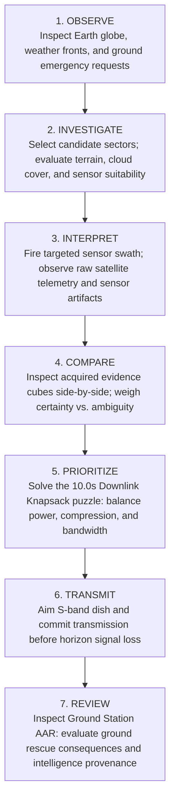

# RC4: CORE GAMEPLAY TRANSFORMATION AUDIT
**From an Operational Command Pipeline to a Compelling Spatial Strategy Game**  
**Project:** ORBIT ZERO: THE LAST DOWNLINK  
**Author:** AI Pair Programmer (Deep Analysis)  
**Date:** October 31, 2026  
**Status:** APPROVED ARCHITECTURAL SPECIFICATION

---

## 1. The Brutally Honest Truth: Why the Current Prototype Feels Flat

The user's critique is 100% accurate:
> *"What is this game? Select scenario, press space, press P, press Q... If a judge looks at this basic game, why would they reward it? 5,000 developers are competing. A globe with a satellite and pressing buttons is not an engaging experience."*

### 1.1 The Root Cause: Checklist vs. Decision Space
In game design theory (specifically spatial puzzle and emergency-simulation design):
- **A Chore / Checklist:** The system presents a sequence of instructions ($A \to B \to C \to D$) where the player has no choices, no ambiguity, and no reason to deduce anything. Pressing keys because a banner ordered you to do so is not gameplay.
- **A Game:** The player is presented with **incomplete information, conflicting observations, strictly limited resources, and irreversible consequences under time pressure**. The player must **OBSERVE $\to$ INVESTIGATE $\to$ INTERPRET $\to$ COMPARE $\to$ PRIORITIZE $\to$ TRANSMIT $\to$ REVIEW**.

### 1.2 Comparison of Existing vs. Transformed Experience

| Dimension | Existing Implementation (Operational Pipeline) | RC4 Transformed Experience (Spatial Strategy Game) |
| :--- | :--- | :--- |
| **Earth Globe** | Passive visual centerpiece with static dot beacons. | **Interactive Investigation Environment:** Hovering/selecting a sector reveals live reconnaissance telemetry (terrain, cloud deck albedo, sensor feasibility, SNR, estimated power). Scanning visibly transforms the sector with flood extent vectors or clear corridors. |
| **Sensor Selection** | Two toggle buttons (Optical / Radar). Player flips to Radar because the text told them to. | **Genuine Sensor Dilemma:** Optical is sharp (0.75m) and cheap (8 Wh), but blind to clouds. SAR penetrates clouds (14 Wh), but suffers from structural metallic dihedral glare around bridges. Player must deduce which sensor matches the crisis terrain. |
| **Evidence Cubes** | Identical-looking cubes that player mechanically processes and queues. | **Distinct Forensic Evidence Artifacts:** Each cube carries visual telemetry, SNR, raw size, and explicit scientific ambiguity warnings. Player can place two cubes side-by-side on the inspection tray to compare optical vs. radar trade-offs. |
| **Processing Cradle** | Mechanical compression step. | **Strategic Power-vs-Bandwidth Dilemma:** Processing costs 6 Wh to vectorize data (4.5s $\to$ 1.8s TX). Player must calculate: *"Do I have the battery to compress 2 cubes? Can I transmit 1 raw cube and 2 compressed cubes within the 10.0s window?"* Crucially: Processing does **not** remove scientific uncertainty. |
| **Downlink Bay** | Standard queue tray. | **Knapsack Horizon Triage Puzzle:** 10.0-second line-of-sight cutoff. Queuing heavy raw packets causes horizon overflow. Reordering, swapping, and sacrificing lower-priority packets determines which ground teams receive actionable data. |
| **Tutorial / Onboarding** | Rigid command prompt: *"Press 2, Press M, Press Space, Press P, Press Q"*. | **Contextual Tactical Intelligence Briefing:** *"Convoys heading toward Sector B. 95% cloud deck. Investigate Sector B and deduce which sensor can penetrate the storm."* Player discovers the solution through spatial deduction. |
| **Debrief / AAR** | Generic score: *"Grade S — 100/100 points"*. | **Consequence-Driven Emergency Outcomes:** Ground rescue outcomes showing lives saved, road reroutings, bridge collapses, and unresolved requests resulting directly from player triage. |

---

## 2. Core Player Fantasy & The 7-Stage Gameplay Loop

**The Player Fantasy:**  
*"You are the lone orbital intelligence specialist aboard a Low Earth Orbit Earth Observation Station during a catastrophic monsoon flood emergency. You have incomplete data, conflicting sensor returns, depleting battery reserves, and exactly one 10-second ground station contact window. You must deliver the right evidence before line-of-sight is lost forever."*

---

## 3. Detailed Specifications for RC4 Milestones

### 3.1 Stage B: Meaningful Earth Investigation & Visual Map Changes
1. **Live Reconnaissance Card:** When a sector is selected (or hovered in VR/desktop):
   - Terrain identification (Headworks, Highway, Cantilever Bridge, Mountain Spur).
   - Real-time weather indicator (`95% CONVECTIVE STORM` vs `CLEAR SKY SLOT`).
   - Sensor suitability matrix (`OPTICAL: BLOCKED (0% SNR)` vs `RADAR: PENETRATES (22.8 dB SNR)`).
   - Resource cost preview (`RADAR: 14 Wh, 4.5s TX`).
2. **Visual Map Transformation:**
   - When Sector B is scanned with Radar: The globe's sector polygon shifts to deep indigo/amber with illuminated flood contours (`FLOOD BOUNDARY DETECTED`).
   - When Sector C is scanned with Optical: The sector polygon illuminates emerald (`APPROACH CLEAR - NO WATER`).
   - When a sector is scanned with the wrong sensor (Optical under clouds): The sector displays a hazy grey cloud mask (`EVIDENCE OCCLUDED`).

### 3.2 Stage C: Evidence Comparison & Uncertainty Interpretation
1. **Side-by-Side Comparison Mode:**
   - In VR: Player can pick up two cubes (one in left hand, one in right hand) or slot them into the two console inspection bays.
   - On Desktop: Selecting an evidence cube opens the Comparison Inspector, allowing direct comparison with previously acquired cubes.
2. **Scientific Ambiguity Warnings:**
   - *Example Sector C Radar:* `METALLIC DIHEDRAL GLARE: Strong corner reflection from steel truss structure masks road deck flood status. Confidence capped at [?] PROBABLE.`
   - *Example Sector E Radar:* `SLOPE LAYOVER AMBIGUITY: Steep topography introduces radar geometric distortion along Km 4. Confidence capped at [?] PROBABLE.`
   - *Example Sector B Optical:* `MIE SCATTERING: Cloud top reflection. Surface zero contact.`

### 3.3 Stage D: Strategic Processing & Downlink Knapsack Capacity Puzzle
1. **The Downlink Window Dilemma:**
   - Total Pass Duration: **10.0 seconds**.
   - Raw Radar Packet: **4.5 seconds**, **3 Storage Units**, **14 Power**.
   - Raw Optical Packet: **4.0 seconds**, **3 Storage Units**, **8 Power**.
   - If player queues 3 raw packets: $4.5 + 4.0 + 4.5 = 13.0\text{ s} > 10.0\text{ s}$! The 3rd packet will be **LOST OVER THE HORIZON**!
2. **The Processing Trade-Off:**
   - Cradle Processing costs **6 Wh Power**.
   - Feature extraction vectorizes flood vectors, shrinking packet from 3 MB to 1 MB, and transmission time from 4.5s to 1.8s.
   - Total Power available: 55 Wh.
   - Optimal strategy requires calculating battery reserves vs. downlink seconds.
3. **Queue Reordering:**
   - Players can reorder queued packets spatially (swapping slots in the bay or pressing `[Q]`). High-priority packets must be transmitted first in case the window cuts off early!

### 3.4 Stage E: Contextual Onboarding & Consequence-Driven Debrief
1. **Removing the Robotic Checklist:**
   - The top banner no longer displays `"Press 2, then M, then Space"`.
   - Instead, it displays the tactical objective:
     * *Objective 1:* `"PRIORITY ALPHA: Emergency convoy dispatched toward Sector B. Dense cloud cover detected. Determine which sensor can penetrate the storm to verify highway flood status."`
     * When player switches to Radar: `"Sensor configured for active microwave penetration. Target Sector B and execute swath."`
2. **Ground Emergency Outcomes Debrief:**
   - Debrief panel details operational impact:
     * `SECTOR B [RADAR]:` *"Verified flood boundary downlinked. Convoys redirected to high ground. 120,000 residents alerted."*
     * `SECTOR C [OPTICAL]:` *"High-res deck clearance confirmed. Emergency bridge open for heavy engineering convoys."*
     * `SECTOR E [RADAR]:` *"Highland evacuation spur verified above floodline; staging depot active."*
     * *Failure states:* Convoys trapped, rescue delayed, resources wasted.

---

## 4. Verification Plan

1. **Unit & Engine Tests:** Update Vitest test suites to verify comparison metrics, ambiguity preservation, and knapsack downlink calculations.
2. **Playwright Headless E2E:** Verify full game loop under both optimal strategy and failure recovery.
3. **Cross-Platform Verification:** Ensure desktop mouse/keyboard and Quest VR hand interactions remain 100% synchronized.

