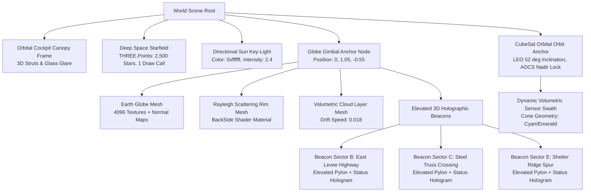

# ORBIT ZERO RC9.0 — PHASE 1 SPECIFICATION
# Deep-Space Orbital Cockpit & Interactive 3D Gimbal Globe

> **Document Version:** 1.0.0  
> **Target Release:** RC9.0 ("Project IGI / Gameloft Spatial Overhaul")  
> **Status:** APPROVED ARCHITECTURAL SPECIFICATION  
> **Target Hardware:** Meta Quest Browser (Horizon OS, WebXR) & Desktop Chromium (Mouse/Keyboard Hybrid)  
> **Performance Envelope:** Quest 3 @ 72/90 FPS, $\le 150$ Draw Calls, $\le 100\text{k}$ Triangles, 0 Garbage Collection Spikes in Frame Loop.

---

## 1. Executive Summary & Problem Statement

### 1.1 The Gameplay & Spatial Defect in RC8.1
In RC8.1, the Earth Globe is essentially a static 3D orb locked at world coordinates `[0.0, 1.05, -0.55]`. While it rotates at a fixed rate ($0.02\text{ rad/s}$) and features cloud drift, the player **cannot interactively rotate the planet, drag to inspect disaster zones, or zoom into tactical regions**. 

Furthermore:
1. **Zero Tactility on Target Sectors:** Target sectors (Indus Basin, East Levee Highway, Steel Truss Bridge) are represented as flat 2D projected line rings directly on the sphere. There is no depth, elevation, or visual affordance inviting interaction.
2. **Disconnected Viewport:** The backdrop relies on an equirectangular milky-way texture without true 3D spatial depth. There is no physical cockpit canopy structure framing the observation viewport, making the player feel like they are floating in an abstract void rather than sitting inside an orbital command deck.
3. **Keyboard Dependency:** Players are instructed to press `[1]`, `[2]`, `[3]` or click 2D HTML badges to select sectors, violating the primary VR mandate: *hands-first, spatial-first*.

### 1.2 The RC9.0 Vision: "Project IGI / Gameloft" Orbital Command
Phase 1 transforms the orbital cockpit into a breathtaking, tactile tactical observation deck inspired by high-budget aerospace simulation games (Project IGI, Gameloft tactical titles):
- A procedural **Deep-Space Starfield** with 2,500 twinkling stars rendered in a **single draw call** via `THREE.Points`.
- A physical **3D Orbital Canopy Frame** with matte-black aerospace composite struts, micro-rivets, and anti-reflective glass glare that frames the panoramic Earth vista.
- A **Physically Responsive Gimbal Globe**:
  - **Desktop:** Left-click + drag smoothly spins the globe with physical angular momentum and exponential damping. Mouse wheel smoothly zooms between `0.38m` (micro-tactical Sindh inspection) and `0.85m` (macro-orbital synoptic view).
  - **WebXR:** Direct one-hand grab to rotate the globe in real time; two-hand pinch gesture to scale/zoom.
- **Elevated 3D Holographic Beacons**: Floating tactical pylons projecting $40\text{mm}$ above the surface of Sectors B, C, and E. Clicking or poking a beacon automatically triggers a smooth, damped spherical slerp that rotates the globe to frame that disaster zone directly beneath the CubeSat sensor swath.

---

## 2. Architectural Blueprint & Scene Graph Hierarchy



### 2.1 Spatial Transformations & Coordinate Standards
- **Cockpit Eye Point (Neutral Seated HMD):** $[0.0, 1.25, 0.0]\text{ m}$.
- **Globe Gimbal Center:** $[0.0, 1.05, -0.55]\text{ m}$ (comfortably within the $0.35\text{m} - 0.65\text{m}$ forward reach envelope).
- **Default Globe Radius:** $R_{\text{globe}} = 0.20\text{ m}$ ($40\text{ cm}$ diameter).
- **Zoom Distance Bounds:**
  - $Z_{\min} = -0.38\text{ m}$ (Close-up: 18cm from player's eyes, maximum tactical inspection).
  - $Z_{\max} = -0.85\text{ m}$ (Wide: synoptic view of global orbital track).
  - $Z_{\text{default}} = -0.55\text{ m}$ (Balanced default).

---

## 3. Detailed Component & System Specifications

### 3.1 Procedural Deep-Space Starfield (`src/scene-assets/starfield.scene-asset.ts`)
To eliminate the flat backdrop while staying within strict Quest 3 GPU limits:
- **Geometry:** `THREE.BufferGeometry` with 2,500 vertices distributed randomly on a spherical shell of radius $R = 85.0\text{ m}$.
- **Attributes:**
  - `position`: `Float32Array(7500)`
  - `color`: `Float32Array(7500)` — spectral distribution based on Harvard stellar classification (65% Class M/K warm orange-red `[1.0, 0.85, 0.7]`, 25% Class G/F solar white `[1.0, 1.0, 1.0]`, 10% Class A/B electric blue `[0.75, 0.88, 1.0]`).
  - `size`: `Float32Array(2500)` — apparent magnitude distribution ($1.2\text{px}$ to $3.5\text{px}$).
  - `twinklePhase`: `Float32Array(2500)` — randomized starting phase for scintillation.
- **Shader Material:** `THREE.ShaderMaterial` using a tiny vertex/fragment shader pair that modulates star brightness via `sin(time * 2.0 + twinklePhase)`.
- **Performance:** **Exactly 1 draw call**, zero texture memory, 0 overhead during frame loop.

```glsl
// Fragment Shader snippet
uniform float uTime;
varying vec3 vColor;
varying float vTwinklePhase;

void main() {
    float dist = length(gl_PointCoord - vec2(0.5));
    if (dist > 0.5) discard;
    float alpha = smoothstep(0.5, 0.1, dist);
    float twinkle = 0.75 + 0.25 * sin(uTime * 3.14159 + vTwinklePhase);
    gl_FragColor = vec4(vColor * twinkle, alpha * twinkle);
}
```

### 3.2 3D Curved Orbital Cockpit Canopy Frame (`src/scene-assets/cockpit-canopy.scene-asset.ts`)
To provide tactile grounding and a sense of physical scale inside Horizon OS:
- **Structure:** Author a procedural composite canopy mesh consisting of:
  - 4 structural curved A-pillars running from the desk perimeter $[x = \pm 0.85, y = 0.75, z = -0.15]$ up and over the player's head to $[x = \pm 0.45, y = 1.95, z = -0.45]$.
  - Horizontal brow strut framing the upper third of the field of view, preventing top-edge clipping.
  - Matte-black PBR finish (`roughness: 0.82`, `metalness: 0.35`, `color: 0x11161d`) with subtle amber emergency indicator LED strips embedded in the upper frame corners.
- **Window Glass Glare:** A subtle transparent plane (`opacity: 0.04`, `roughness: 0.1`, `metalness: 0.9`) with Fresnel reflection facing the Sun key-light, producing realistic orbital glass glare as the satellite passes the terminator.

### 3.3 Interactive 3D Gimbal Globe Engine (`src/systems/desktopControls.ts` & `src/systems/missionControlSystem.ts`)

#### A. Rotational Physics & Momentum (Desktop Mouse & WebXR Hands)
The globe rotation must feel physical, heavy, and planetary—not like an instant, jerky CAD transform:
- **State Variables:**
  - `currentRotation: THREE.Quaternion`
  - `targetRotation: THREE.Quaternion`
  - `angularVelocity: THREE.Vector2` (yaw, pitch)
  - `isDragging: boolean`
  - `lastMousePos: THREE.Vector2`
  - `dampingFactor: 0.92` (smooth exponential coasting)
- **Input Handling:**
  - `pointerdown`: Raycast against `globePickMesh` (an invisible sphere with radius $R = 0.22\text{m}$, slightly larger than the visual globe for easy grabbing). If hit, set `isDragging = true`, store mouse screen position.
  - `pointermove`: If `isDragging`, compute $\Delta x = x - x_{\text{prev}}$, $\Delta y = y - y_{\text{prev}}$.
    $$\omega_y = \Delta x \times \text{sensitivity} \quad (\text{yaw})$$
    $$\omega_x = \Delta y \times \text{sensitivity} \quad (\text{pitch})$$
    Apply incremental rotation via quaternion multiplication along camera up and right axes.
  - `pointerup`: Release drag. Globe continues spinning with `angularVelocity * dampingFactor` until $|\omega| < 0.0001$.
- **WebXR Hand Support:**
  - When in XR mode, attach `OneHandGrabbable` to the `GlobeGimbalPivot`. Squeezing with grip or pinching with index/thumb applies rotation mapped directly to hand angular delta.
  - Two-hand pinch distance calculates scale ratio: $s = d_{\text{current}} / d_{\text{initial}}$, clamped to zoom limits.

#### B. Mouse Wheel Smooth Focal Zoom
- Scrolling mouse wheel updates target focal distance $Z_{\text{target}}$:
  $$Z_{\text{target}} = \text{clamp}(Z_{\text{target}} + \Delta \text{wheel} \times 0.0008, -0.85, -0.38)$$
- Frame update applies critically damped spring interpolation:
  $$Z_{\text{current}} = \text{lerp}(Z_{\text{current}}, Z_{\text{target}}, 1.0 - e^{-12 \times \Delta t})$$
- Moving closer to $Z = -0.38\text{m}$ automatically fades in micro-topographic height lines and sector details on the Indus River Basin.

### 3.4 Elevated 3D Holographic Beacons (`src/scene-assets/sector-beacon.scene-asset.ts`)
Instead of flat lines, each target sector features a diegetic holographic beacon:
- **Geometry:**
  - Vertical holographic beacon pylon ($h = 45\text{mm}$, diameter $4\text{mm}$) extending outward along the globe normal vector.
  - Floating tactical ring collar ($r = 16\text{mm}$) orbiting the pylon at $1.5\text{ rev/s}$.
  - Hexagonal diamond target reticle hovering at the top of the pylon with sector designation:
    - **Sector B:** Amber beacon (`0xffaa22`), Convective storm icon, *"SECTOR B: LEVEE ROAD"*.
    - **Sector C:** Cyan beacon (`0x22d3ee`), Clear sky icon, *"SECTOR C: STEEL TRUSS BRIDGE"*.
    - **Sector E:** Emerald beacon (`0x10b981`), High-elevation ridge icon, *"SECTOR E: SHELTER SPUR"*.
- **Click / Poke Interaction:**
  - Raycast hitting the beacon collar or diamond fires `SELECT_SECTOR(sectorId)`.
  - The Globe Gimbal immediately initiates a smooth spherical interpolation (Slerp, duration $0.65\text{s}$, cubic-bezier ease-out) that rotates the globe to bring the chosen beacon directly to the top-center nadir point beneath the CubeSat.
  - Visual feedback: Beacon expands with an expanding sonic pulse ring, and Voice Commander ARIA-7 acknowledges sector lock.

---

## 4. Advanced Recommendations & Architectural Enhancements

### Recommendation 1.1: Raycast Drag vs. Click Separation (Zero Jitter)
A notorious bug in WebXR/desktop hybrid games occurs when the player attempts to click a beacon but slightly drags the mouse, triggering a drag event instead of a selection.
- **Implementation Enhancement:** Implement a movement threshold buffer:
  - If total pointer travel while depressed is $< 4\text{px}$, treat `pointerup` as an **Intentional Click/Select**.
  - If total pointer travel $\ge 4\text{px}$, treat as an **Orbital Drag**, suppressing beacon click events.

### Recommendation 1.2: Day/Night Solar Terminator Dynamic Alignment
In real Earth observation, optical satellite sensors are useless on the night side of the planet unless artificial illumination or thermal infrared is available.
- **Implementation Enhancement:** Connect the directional Sun key-light angle to the mission simulation timeline. Indus Basin enters the pass during dawn/daylight conditions. The atmospheric rim shader dynamically displays Rayleigh scattering (deep orange at the terminator line, brilliant electric blue on the daylight horizon, deep velvet black in the orbital shadow).

### Recommendation 1.3: Projected Satellite Ground Track & Live Swath Footprint
When the CubeSat orbits the globe, show a dynamic ground track projection:
- A dashed orbital trajectory ring encircling the globe at $52^\circ$ inclination.
- A glowing trapezoid on the surface of the globe directly beneath the CubeSat sensor beam showing the active ground swath width ($60\text{ km}$ equivalent scale).

---

## 5. Quest 3 Performance & GPU Budget

| Metric | RC8.1 Baseline | Phase 1 Budget Target | Verification Method |
| :--- | :--- | :--- | :--- |
| **Draw Calls** | 142 | **$\le 146$** (+1 Starfield, +1 Canopy, +2 Beacons) | Spector.js / Playwright WebGL Profiler |
| **Triangles** | 48,200 | **$\le 58,000$** (+2,500 Starfield points, +7,300 Canopy) | Three.js `renderer.info.render.triangles` |
| **Frame Time (Quest 3)** | 9.4 ms | **$\le 10.8$ ms** (Headroom for 90 FPS @ 11.1ms) | OVR Metrics Tool / Chromium Trace |
| **Garbage Collection** | 0 allocations | **0 allocs/frame** (Pre-allocated vectors & quaternions) | Chrome DevTools Memory Profiler |

---

## 6. Verification & Acceptance Gate (Phase 1)

1. **Unit Test Gate:** 117 tests in `src/mission/` must pass without regressions (`npm test`).
2. **Build Gate:** `npm run build` passes with zero TypeScript warnings or Rollup errors.
3. **Interactive E2E Test (`tests/phase1-gimbal-globe.spec.mjs`):**
   - Assert mouse drag rotates the globe rotation quaternion by $> 0.2\text{ rad}$.
   - Assert mouse wheel updates globe distance between $-0.38\text{m}$ and $-0.85\text{m}$.
   - Assert clicking 3D Sector B beacon rotates Sector B to top nadir and updates `missionState.selectedSector = 'B'`.
   - Assert draw calls stay $\le 146$.
4. **Physical Inspection:** Verified in IWER WebXR emulator and Quest Browser.

