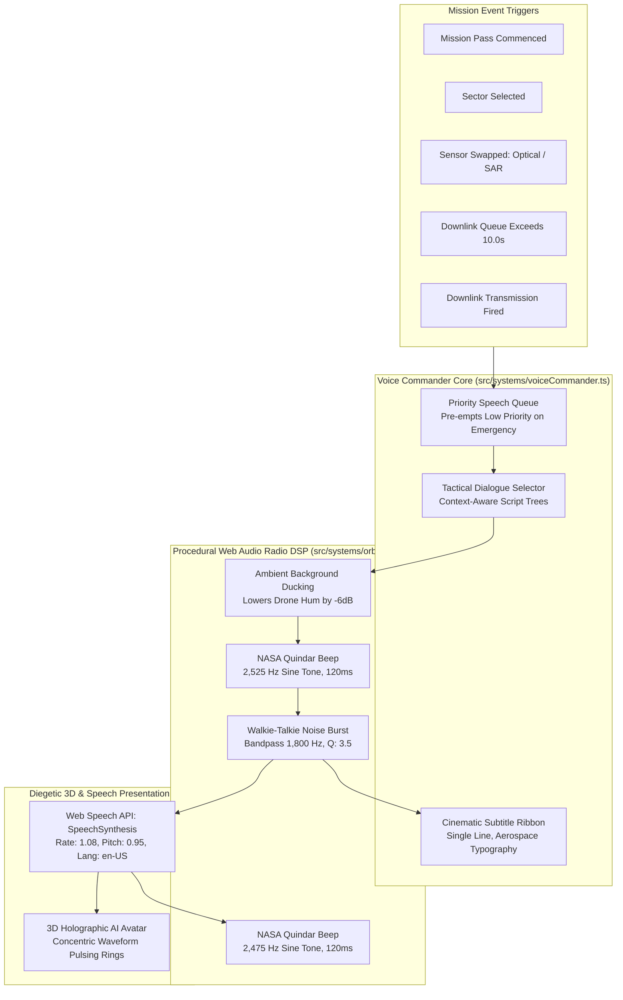

# ORBIT ZERO RC9.0 — PHASE 2 SPECIFICATION
# "COMMANDER ARIA-7" — IGI/Gameloft Holographic Voice Handler & Radio DSP

> **Document Version:** 1.0.0  
> **Target Release:** RC9.0 ("Project IGI / Gameloft Spatial Overhaul")  
> **Status:** APPROVED ARCHITECTURAL SPECIFICATION  
> **Target Hardware:** Meta Quest Browser (Horizon OS, WebXR) & Desktop Chromium  
> **Audio Envelope:** Web Audio API Procedural DSP + Web Speech API Synthesis + Zero External Assets.

---

## 1. Executive Summary & Problem Statement

### 1.1 The Gameplay Defect in RC8.1
In RC8.1, the game presents dense walls of 2D technical text across multiple HTML cards (`#briefing-panel`, `#recon-card`, `#compare-card`, `#queue-card`). During emergency pass operations:
- A new player is confronted with over 400 words of scientific explanations (Mie droplet extinction, radar backscatter $\sigma^0 < -22\text{ dB}$, Rayleigh scattering, knapsack optimization algorithms).
- In virtual reality or on desktop, players do not want to read paragraphs of fine print while a 10-second downlink window ticks down.
- The game feels silent and clinical, lacking the gripping tension of tactical military operations (such as the briefing voices in *Project IGI*, *Homeworld*, or *Ace Combat*).

### 1.2 The RC9.0 Vision: "Commander ARIA-7" Diegetic AI Operator
Phase 2 completely eliminates text overload by introducing **COMMANDER ARIA-7** (Autonomous Reconnaissance Intelligence Assistant, MK-VII):
1. **Physical 3D Holographic Avatar:** Mounted on the left cockpit console at `[-0.42, 1.15, -0.48]`. A glowing tactical wireframe visage surrounded by concentric, audio-reactive waveform rings that pulse, expand, and rotate in real time when ARIA speaks.
2. **Procedural Radio DSP & Quindar Tones:** Every transmission begins with a realistic military walkie-talkie squelch burst (1,800 Hz bandpass noise burst) and an authentic Apollo/NASA Quindar tone pair (2,525 Hz intro / 2,475 Hz outro), creating instant aerospace authenticity without downloading any external MP3/WAV files.
3. **Tactical Spoken Dialogue:** Uses the native browser `window.speechSynthesis` tuned to a crisp, professional tactical cadence (rate: 1.08, pitch: 0.95), dynamically delivering mission briefings, sensor triage coaching, and downlink warnings.
4. **Cinematic Subtitle Ribbon:** Verbose HTML cards are replaced by an elegant, single-line diegetic subtitle ribbon at the bottom of the viewport, maintaining total visibility of the 3D Earth Globe and cockpit.

---

## 2. System Architecture & Audio Pipeline



---

## 3. Detailed Component Specifications

### 3.1 3D Holographic AI Avatar (`src/scene-assets/avatar-aria.scene-asset.ts`)
Mounted on the left angled console bracket at $[x = -0.42, y = 1.15, z = -0.48]$:
- **Geometry:**
  - **Core Visage:** An icosahedron wireframe diamond core ($r = 0.045\text{ m}$) rendered with an emerald/cyan emissive wireframe shader (`color: 0x06b6d4`, `wireframe: true`).
  - **Audio-Reactive Waveform Rings:** 3 concentric outer rings ($r_1 = 0.065\text{m}, r_2 = 0.085\text{m}, r_3 = 0.105\text{m}$) inclined at $25^\circ, -35^\circ, 45^\circ$.
- **Dynamic Animation & Audio-Reactivity:**
  - Idle state: Slow, smooth gyroscopic gimbal rotation ($0.5\text{ rad/s}$) with breathing emissive intensity ($0.4 \to 0.7$).
  - Speaking state: Rings expand in radius by $+25\%$, spin rapidly ($3.2\text{ rad/s}$), and jitter with procedural noise derived from the audio playback envelope, creating the appearance of a live military AI speaking.

### 3.2 Procedural Military Radio DSP (`src/systems/orbitalAudio.ts`)
All sound effects are 100% procedurally synthesized in real time via Web Audio API, guaranteeing zero network requests and zero latency:

#### A. NASA Apollo Quindar Tone Generator
```typescript
export function playQuindarTone(ctx: AudioContext, isIntro: boolean): void {
  const osc = ctx.createOscillator();
  const gain = ctx.createGain();
  // 2,525 Hz for PTT key-down (intro); 2,475 Hz for PTT key-up (outro)
  osc.type = 'sine';
  osc.frequency.setValueAtTime(isIntro ? 2525 : 2475, ctx.currentTime);

  gain.gain.setValueAtTime(0.001, ctx.currentTime);
  gain.gain.exponentialRampToValueAtTime(0.08, ctx.currentTime + 0.015);
  gain.gain.exponentialRampToValueAtTime(0.001, ctx.currentTime + 0.12);

  osc.connect(gain);
  gain.connect(ctx.destination);
  osc.start(ctx.currentTime);
  osc.stop(ctx.currentTime + 0.13);
}
```

#### B. Walkie-Talkie Bandpass Radio Squelch Burst
```typescript
export function playRadioSquelchBurst(ctx: AudioContext): void {
  const bufferSize = ctx.sampleRate * 0.09; // 90ms burst
  const noiseBuffer = ctx.createBuffer(1, bufferSize, ctx.sampleRate);
  const output = noiseBuffer.getChannelData(0);
  for (let i = 0; i < bufferSize; i++) {
    output[i] = Math.random() * 2 - 1;
  }

  const whiteNoise = ctx.createBufferSource();
  whiteNoise.buffer = noiseBuffer;

  const bandpass = ctx.createBiquadFilter();
  bandpass.type = 'bandpass';
  bandpass.frequency.setValueAtTime(1800, ctx.currentTime); // Military voice VHF band
  bandpass.Q.setValueAtTime(3.5, ctx.currentTime);

  const gain = ctx.createGain();
  gain.gain.setValueAtTime(0.12, ctx.currentTime);
  gain.gain.exponentialRampToValueAtTime(0.001, ctx.currentTime + 0.09);

  whiteNoise.connect(bandpass);
  bandpass.connect(gain);
  gain.connect(ctx.destination);
  whiteNoise.start(ctx.currentTime);
}
```

### 3.3 Dynamic Tactical Dialogue Script Trees

| Trigger Condition | ARIA-7 Spoken Dialogue | Subtitle Text (Bottom HUD) | Priority |
| :--- | :--- | :--- | :--- |
| **Pass Start** | *"Orbit Zero online. Category 4 monsoon breached Indus levees—120,000 civilians trapped. 55 Watt-hours remaining. Select a sector on the globe to begin."* | `[ARIA-7] Indus levees breached. 55 Wh online. Select target sector on globe.` | High |
| **Sector B (Storm) + Optical Armed** | *"Warning! Sector B is under 95% storm clouds. Optical light will scatter—switch to C-Band Active SAR to pierce the cloud deck!"* | `[ARIA-7] WARNING: Sector B under 95% cloud deck. Switch to Active SAR to penetrate.` | Critical |
| **Sector B (Storm) + SAR Armed** | *"Sensor lock optimal. C-band radar will penetrate rain cores. Fire the swath scan."* | `[ARIA-7] OPTIMAL LOCK: SAR armed for cloud penetration. Ready to fire.` | Medium |
| **Sector C (Clear Bridge) + SAR Armed** | *"Hold on! Sector C is a steel truss bridge under clear skies. Radar will bounce off metal structures creating multipath glare. Switch to High-Res Optical!"* | `[ARIA-7] CAUTION: Steel truss bridge causes radar multipath glare. Use High-Res Optical.` | Critical |
| **Sector C (Clear Bridge) + Optical Armed** | *"Visual lock confirmed. Clear atmospheric window. High-res optical will capture road clearance. Fire swath."* | `[ARIA-7] OPTIMAL LOCK: Clear skies. Optical camera calibrated. Fire swath.` | Medium |
| **Sector E (Shelter Spur) + SAR Armed** | *"Shelter ridge locked. Steep topography causes radar layover distortion. Optical recommended if cloud deck allows."* | `[ARIA-7] ADVISORY: Radar layover risk on ridge slope. Optical recommended.` | Low |
| **Downlink Queue $> 10.0\text{ s}$** | *"Warning! Total downlink time exceeds our 10-second Karachi horizon window! Drag raw data cubes into the Amber Cradle to run onboard compression."* | `[ARIA-7] DOWNLINK OVERFLOW: Queue exceeds 10.0s window! Compress packets in Amber Cradle.` | Critical |
| **Downlink Transmit Fired** | *"Downlink handshake locked to Karachi station. Streaming telemetry packets now. Keep alignment steady!"* | `[ARIA-7] TRANSMITTING: Karachi downlink laser active. Streaming verified packets.` | High |
| **Debrief / S-Rank Won** | *"Outstanding triage, Operator! Karachi rescue teams have clear road vectors. 120,000 citizens evacuated. Mission Grade: S-Rank."* | `[ARIA-7] MISSION ACCOMPLISHED: 120,000 evacuated. S-Rank orbital mastery.` | High |

---

## 4. Advanced Recommendations & Architectural Enhancements

### Recommendation 2.1: Priority Interruption & Audio Ducking
When an emergency occurs (such as an incorrect sensor armed over a storm cloud or queue overflowing 10 seconds), ARIA-7 must immediately cancel any non-essential background chatter:
- Cancel active `window.speechSynthesis.cancel()`.
- Duck the background spacecraft hum (`orbitalAudio.setHumGain(0.02)`) by $-6\text{ dB}$ during speech.
- Restore baseline ambient levels smoothly over $500\text{ms}$ upon speech completion.

### Recommendation 2.2: Speech Synthesis Fallback & Headless Emulation Grace
In automated headless environments (such as Playwright running in Linux Docker or CI/CD pipelines without audio devices), `window.speechSynthesis` may not invoke callbacks or may not exist:
- **Resilient Fallback:** Wrap all speech calls in a fallback timer. If `onend` does not fire within `(text.length * 80)ms`, automatically advance the queue and fire completion events so gameplay never hangs.
- Display subtitles at all times regardless of speech synthesis audio availability.

### Recommendation 2.3: Tactile Mute / Voice Repeat Console Toggle
Provide a physical diegetic 3D button on the left desk:
- `[VOICE COMMS: ACTIVE / MUTED]` (`Key: M` or physical button poke).
- When muted, audio DSP and speech are silenced, but cinematic subtitles continue to render.

---

## 5. Performance Budget & Resource Impact

- **Audio DSP Nodes:** Max 4 simultaneous Web Audio nodes (1 Oscillator, 1 BufferSource, 1 BiquadFilter, 1 GainNode). Recycled immediately after playback.
- **CPU Overhead:** $< 0.5\%$ main thread utilization during active speech.
- **Memory Footprint:** 0 MB external audio downloads (100% procedural Web Audio + browser OS TTS voices).
- **GPU Draw Calls:** +1 draw call for the 3D Holographic AI Avatar mesh.

---

## 6. Verification & Acceptance Gate (Phase 2)

1. **Unit Test Gate:** All 117 tests in `src/mission/` must pass without regressions (`npm test`).
2. **Speech Engine Unit Tests (`tests/voiceCommander.test.ts`):**
   - Assert `voiceCommander.triggerEvent('SECTOR_SELECTED', { sector: 'B', sensor: 'OPTICAL' })` emits the storm optical warning dialogue.
   - Assert `voiceCommander.triggerEvent('QUEUE_OVERFLOW')` triggers the knapsack coaching voice line.
   - Assert speech queue pre-empts low-priority lines when a critical alert arrives.
3. **Playwright Integration Test (`tests/phase2-voice-commander.spec.mjs`):**
   - Verify Quindar audio and squelch burst execute without Web Audio errors.
   - Verify `#aria-subtitle-bar` updates with tactical text within $100\text{ms}$ of trigger.

