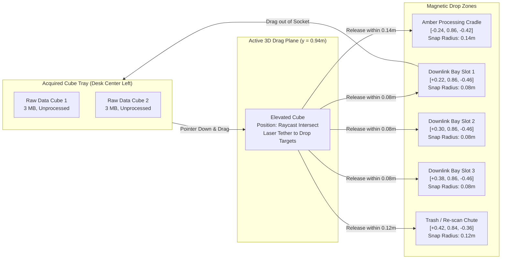

# ORBIT ZERO RC9.0 — PHASE 4 SPECIFICATION
# 3D Physical Drag-and-Drop Data Cubes & Inside-Cube Aerospace Holograms

> **Document Version:** 1.0.0  
> **Target Release:** RC9.0 ("Project IGI / Gameloft Spatial Overhaul")  
> **Status:** APPROVED ARCHITECTURAL SPECIFICATION  
> **Target Hardware:** Meta Quest Browser (Horizon OS, WebXR) & Desktop Chromium  
> **Interaction Model:** 3D Raycast Drag Plane (Desktop) & Proximity Pinch/Grab (WebXR) with Magnetic Snapping.

---

## 1. Executive Summary & Problem Statement

### 1.1 The Gameplay Defect in RC8.1
In RC8.1, acquired evidence cubes are static 3D rectangular blocks spawned on the desk. To process or transmit them:
- The player must press `[P]` (Process in Cradle) or `[Q]` (Queue in Downlink Bay) or click small 2D HTML buttons.
- The cubes themselves are opaque, colored plastic bricks with flat text decals. They do not visually communicate **why** an optical scan failed (cloud occlusion) or **why** a radar scan succeeded (ground moisture contrast).
- In earlier builds, once a cube was queued, it was locked; unqueue recovery required awkward text button cycling.
- This represents a critical missed opportunity: in VR, picking up, inspecting, and physically sliding a memory cartridge into a slot is one of the most gratifying, tactile spatial interactions possible.

### 1.2 The RC9.0 Vision: Holographic Aerospace Evidence Cartridges
Phase 4 re-engineers Data Cubes into **living scientific micro-holograms encased in aerospace-grade crystal glass**:
1. **Inside-Cube Holographic Micro-Environments:**
   - Instead of flat textures, the interior of each cube contains a floating, illuminated 3D miniature representing the physical ground-truth observed by the sensor:
     - `[OK] CONFIRMED`: A glowing 3D wireframe river valley and illuminated highway vector line indicating safe convoy passage.
     - `[?] PROBABLE` (Radar Multipath/Layover): Sharp, jagged crystalline spikes of radar backscatter glare, showing microwave reflection off steel bridges.
     - `[X] UNVERIFIED` (Cloud Occluded): A dense, swirling white volumetric cloud block obscuring the valley floor, visually demonstrating Optical Mie scattering extinction.
2. **True 3D Spatial Drag-and-Drop with Magnetic Snapping:**
   - **Click & Lift:** Clicking or pinching a cube lifts it $80\text{mm}$ off the desk with a gentle levitation glow.
   - **Raycast Drag Plane:** Moves freely across a constrained 3D planar grid above the console desk.
   - **Trajectory Tether:** A glowing laser line draws dynamically from the cube to the nearest valid magnetic snap zone.
3. **Amber Processing Cradle Compression Finale:**
   - Dropping an uncompressed cube ($3\text{ MB} / 3.3\text{s}$) into the cradle triggers a 1.0-second laser-ring compression sequence: rotating scanning rings, particle burst, cube scale shrinks to 70%, and interior glow transforms to dense golden photon data ($1\text{ MB} / 1.1\text{s}$), deducting 6 Wh.
4. **Physical Downlink Bay Slotting & Drag-Out Unqueue Recovery:**
   - Releasing a cube over Downlink Bay sockets (Slots 1, 2, or 3) snaps it into the chassis with a satisfying mechanical clamp.
   - Grabbing a slotted cube and pulling it out of the bay returns it to the triage tray, instantly freeing up time on the 10.0s downlink window gauge.

---

## 2. Spatial Architecture & Snap Zone Layout

---

## 3. Detailed Component Specifications

### 3.1 Translucent Crystal Glass & Inside Micro-Holograms (`src/scene-assets/data-cube.scene-asset.ts`)
Each evidence cube is constructed as a two-layer compound mesh:

#### A. Outer Housing (Aerospace Crystal Glass)
- Dimensions: $50\text{mm} \times 50\text{mm} \times 50\text{mm}$ with beveled edges ($2\text{mm}$ chamfer).
- Material: `MeshPhysicalMaterial`
  - `transmission: 0.88`
  - `roughness: 0.12`
  - `ior: 1.52` (Crown optical glass)
  - `thickness: 0.02`
  - `emissiveIntensity: 0.25` (Tinted to sensor type: Cyan for Optical, Emerald for SAR)

#### B. Interior 3D Micro-Hologram Scenarios
Suspended at the geometric center of the cube ($[0, 0, 0]$ local space):

1. **`CONFIRMED` Evidence (e.g. Sector B SAR / Sector C Optical):**
   - A miniature 3D topographic relief mesh ($35\text{mm} \times 35\text{mm}$, 128 vertices).
   - Crisp glowing vector line running through the valley floor:
     - Blue/Cyan vector = Evacuation highway clear of standing water.
     - Gold pulse = Convoy route clearance badge.
2. **`PROBABLE` Evidence with Ambiguity (e.g. Sector C SAR Metal Multipath):**
   - Topographic relief mesh overlain with 8 sharp, jagged red/amber crystalline spikes protruding vertically ($25\text{mm}$ height).
   - Spikes pulse at $5\text{ Hz}$, visually representing erratic radar reflections bouncing off steel truss bridge girders.
3. **`UNVERIFIED` Evidence (e.g. Sector B Optical Cloud Occlusion):**
   - A dense cluster of 60 volumetric particle spheres ($r = 3\text{mm}$, soft cloud texture, opacity $0.85$).
   - Swirls slowly inside the cube, completely blocking view of the ground plane beneath, visually demonstrating Mie scattering opacity ($\tau > 15$).

### 3.2 3D Drag-and-Drop Physics Engine (`src/systems/desktopControls.ts`)

#### A. Drag Plane & Raycast Hit-Testing
1. **Raycast Plane:** An invisible horizontal plane defined at $y_{\text{drag}} = 0.94\text{ m}$ ($80\text{mm}$ above desk level).
2. **Interaction Initiation:**
   - On `pointerdown` (Desktop mouse or VR index pinch), raycast intersects `CubeCollisionMesh`.
   - Store offset: $\vec{o} = \vec{P}_{\text{cube}} - \vec{P}_{\text{intersect}}$.
   - Mark `cube.isBeingDragged = true`.
   - Lift cube smoothly to $y = 0.94\text{m}$ using critically damped spring ($150\text{ms}$).
3. **Tracking & Magnetic Snap Sniffing:**
   - On each frame, update cube position:
     $$\vec{P}_{\text{target}} = \vec{P}_{\text{raycast}} + \vec{o}$$
   - Calculate Euclidean distance $d_i = \|\vec{P}_{\text{target}} - \vec{P}_{\text{snap}, i}\|$ to all registered snap zones.
   - If $\min(d_i) \le R_{\text{snap}}$:
     - Cube position biases smoothly toward snap zone: $\vec{P}_{\text{cube}} = \text{lerp}(\vec{P}_{\text{target}}, \vec{P}_{\text{snap}}, 0.65)$.
     - Render luminous magnetic trajectory tether from cube to snap socket.
     - Play subtle magnetic hover buzz in Web Audio ($220\text{Hz}$ tone).

#### B. Snap Execution & State Transitions
- **Snap to Amber Processing Cradle:**
  - Deduct 6 Wh from battery.
  - Animate 3 concentric laser rings descending around the cube over $1.0\text{s}$.
  - Play high-frequency laser compression chirp (`1200Hz -> 3200Hz`).
  - Cube scale transitions from $1.0 \to 0.70$ ($35\text{mm}$).
  - Glass color shifts to compressed gold (`#f59e0b`).
  - Mission state updates: cube telemetry converted to compressed feature packet ($1\text{ MB}$, $1.1\text{s}$ downlink time).
- **Snap to Downlink Bay Socket (1, 2, or 3):**
  - Cube snaps flush into the socket ($y = 0.865\text{m}$).
  - Mechanical bay clamps slide forward with an audible metallic latch.
  - Mission state updates: cube added to transmission queue.
  - 10.0s contact window gauge updates to show new total transmission time.

### 3.3 Physical Unqueue Recovery Interaction
If the player wants to reclaim or re-process a queued cube:
- The player clicks/pinches the slotted cube in the Downlink Bay and drags it forward ($z > -0.40\text{m}$) or left ($x < 0.0\text{m}$).
- Once pulled past $40\text{mm}$ from the socket center, bay clamps release with a click.
- The cube returns to active triage status, instantly removed from the transmission queue.
- Total queued time on the window gauge reduces immediately, granting total player agency.

---

## 4. Advanced Recommendations & Architectural Enhancements

### Recommendation 4.1: Quick-Double-Click Auto-Routing
For power players and desktop testing efficiency:
- If a player **double-clicks** an evidence cube on the triage tray:
  - If the cube is uncompressed and battery $\ge 6\text{Wh}$, auto-fly it smoothly to the Amber Cradle.
  - If the cube is already compressed or window capacity permits, auto-fly it to the next empty Downlink Bay slot.
  - Maintains full physical drag-and-drop while offering swift desktop convenience.

### Recommendation 4.2: Visual Data Density Hologram Shader
Instead of static meshes, animate the internal hologram wireframe with a scrolling scanline shader:
- A horizontal laser plane sweeps up and down through the micro-terrain every $2.0\text{s}$.
- Gives the sensation that satellite AI is actively segmenting the road infrastructure in real time.

### Recommendation 4.3: Haptic Feedback on Meta Quest Controllers & Hands
When running in WebXR:
- Pulse the controller linear resonant actuator (LRA) with a $40\text{ms}$ crisp burst when entering a magnetic snap zone.
- Fire a heavier $80\text{ms}$ confirmation pulse when released and locked into a bay socket.

---

## 5. Performance Budget & Resource Impact

- **Draw Calls:** +4 draw calls (1 Instanced Mesh for outer cube glass casings, 3 draw calls for internal micro-holograms: terrain wireframe, radar spikes, cloud particles).
- **Triangles:** ~6,800 triangles across 3 active data cubes.
- **Garbage Collection:** 0 allocations during dragging (pre-allocated reusable `THREE.Vector3` and `THREE.Raycaster` instances).

---

## 6. Verification & Acceptance Gate (Phase 4)

1. **Unit Test Gate:** 117 tests in `src/mission/` must pass without regressions (`npm test`).
2. **E2E 3D Drag-and-Drop Test (`tests/phase4-drag-drop-cubes.spec.mjs`):**
   - Acquire an evidence cube via 3D swath button.
   - Simulate mouse drag from triage tray to Amber Cradle coordinates $[-0.24, 0.86, -0.42]$.
   - Assert cube undergoes compression: size shrinks to 70%, packet size becomes 1 MB, 6 Wh deducted.
   - Simulate mouse drag from Cradle to Downlink Bay Slot 1 $[0.22, 0.86, -0.46]$.
   - Assert cube is queued and window gauge registers $1.1\text{s}$.
   - Simulate mouse drag from Bay Slot 1 back to triage tray.
   - Assert cube is unqueued and window gauge resets to $0.0\text{s}$.

