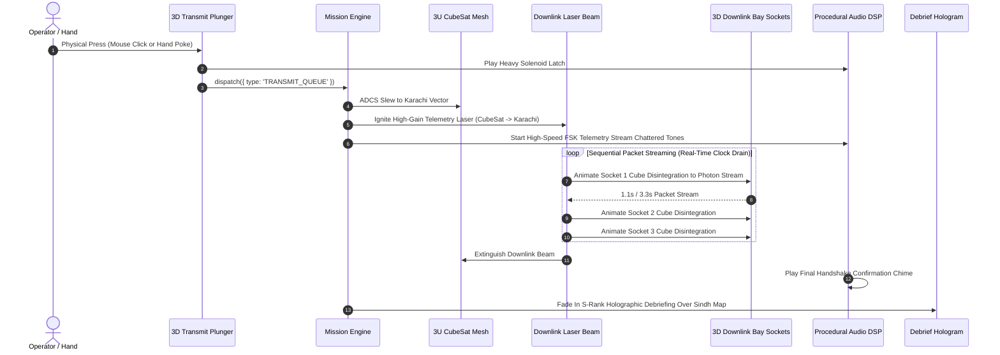

# ORBIT ZERO RC9.0 — PHASE 5 SPECIFICATION
# Cinematic Downlink Sequence & VR Hand-Simulator Verification Harness

> **Document Version:** 1.0.0  
> **Target Release:** RC9.0 ("Project IGI / Gameloft Spatial Overhaul")  
> **Status:** APPROVED ARCHITECTURAL SPECIFICATION  
> **Target Hardware:** Meta Quest Browser (Horizon OS, WebXR) & Desktop Chromium  
> **Diagnostic Tools:** In-Engine WebXR Ergonomic Hand Simulator (`Key: H` / `?vrSim=1`).

---

## 1. Executive Summary & Problem Statement

### 1.1 The Gameplay & Verification Defect in RC8.1
In RC8.1:
1. **Anti-climactic Downlink Finale:** When the player transmits the downlink queue, the transmission is instant or displays a simple progress bar on a 2D HTML card. There is no sense of physical radio-frequency (RF) or laser transmission from space to Earth. The satellite does not point its high-gain antenna, and Karachi Ground Station does not visibly receive telemetry.
2. **Verification Blind Spot (Headset Access Gap):** Without a physical Quest 3 headset plugged into ADB every five minutes, developers cannot easily verify whether new 3D spatial buttons, cubes, and cradles conform to the strict seated VR reach envelope ($0.35\text{m} - 0.65\text{m}$), or whether IWSDK pinch/poke events fire properly.

### 1.2 The RC9.0 Vision: Cinematic Climax & Emulated Spatial Verification
Phase 5 introduces:
1. **Cinematic High-Intensity Telemetry Laser Finale:**
   - Pressing the physical 3D red `[TRANSMIT DOWNLINK]` plunger triggers a dramatic, synchronized sequence:
   - The orbiting 3U CubeSat re-orients its high-gain optical downlink terminal toward the **Karachi Ground Station** marker on the globe.
   - A pulsing, volumetric cyan laser beam connects the spacecraft directly to Karachi.
   - Packets stream sequentially from Downlink Bay sockets 1, 2, and 3, disintegrating into photon streams that travel along the beam.
   - The 10.0-second countdown clock drains in real time with high-speed telemetry telemetry audio bursts, culminating in mission debriefing.
2. **In-Engine VR Hand & Ergonomic Simulator (`Key: H` / `?vrSim=1`):**
   - A desktop developer harness that renders articulated, translucent Quest 3 hand proxies directly in the Three.js viewport.
   - Controlled via mouse movement (hand position) and Right-Click (pinch gesture).
   - Draws a diegetic seated ergonomic dome displaying exact reach zones ($0.35\text{m}$ green inner zone, $0.55\text{m}$ yellow optimal zone, $0.65\text{m}$ red maximum boundary), proving seated compliance without requiring a physical headset.

---

## 2. Cinematic Downlink Sequence Pipeline

---

## 3. Detailed Component Specifications

### 3.1 Volumetric Downlink Telemetry Laser (`src/scene-assets/downlink-laser.scene-asset.ts`)
- **Geometry:** A dynamic cylinder geometry stretching from the live position of the orbiting CubeSat $\vec{P}_{\text{sat}}(t)$ to the Karachi Ground Station marker $\vec{P}_{\text{karachi}}(t)$ on the rotating globe:
  $$\vec{D} = \vec{P}_{\text{karachi}} - \vec{P}_{\text{sat}}, \quad L = \|\vec{D}\|$$
- **Shader:** Custom additive glow shader:
  - Inner core: Brilliant white-hot laser filament ($r = 0.003\text{m}$, opacity $1.0$).
  - Outer sheath: Electric cyan plasma beam ($r = 0.018\text{m}$, opacity $0.45$), scrolling forward at $12.0\text{ m/s}$ using a sawtooth UV offset.
- **Ground Station Reception Footprint:**
  - Where the laser strikes Karachi on the globe, render a pulsing circular dish reception field ($r = 15\text{mm}$) with expanding shockwave ripples representing high-throughput RF/optical demodulation.

### 3.2 Real-Time Downlink Countdown & Packet Streaming
- The 10.0-second countdown bar on the desk counts down in exact 100ms intervals.
- As each packet is transmitted:
  - The corresponding Data Cube inside Downlink Bay Slot 1, 2, or 3 emits an upward photon stream.
  - The cube dissolves via a procedural noise-dissolve shader into golden particles that accelerate upward toward the satellite beam.
  - Audio generates high-speed Frequency Shift Keying (FSK) telemetry beeps: rapid data bursts alternating between $1,200\text{Hz}$ and $2,200\text{Hz}$ (Bell 202 standard simulation).

### 3.3 VR Hand & Reach Envelope Debugger (`src/systems/vrHandSimulator.ts`)

#### A. Architecture & Activation
- Enabled via query parameter `?vrSim=1` or pressing `Key: H` on desktop.
- Creates two virtual articulated hand models representing Meta Quest 3 controllers/hands:
  - Left hand anchored in resting idle pose.
  - Right hand follows the 3D mouse cursor in world space, projected at the current active desk depth.

#### B. Ergonomic Reach Envelope Dome
When enabled, renders a diegetic wireframe spherical coordinate shell centered at the player's neutral head position $[0.0, 1.25, 0.0]$:
1. **Green Zone ($r \le 0.45\text{m}$):** "Primary Reach Zone" — perfectly accessible with bent elbows. Desk buttons, swath plunger, and triage tray sit here.
2. **Yellow Zone ($0.45\text{m} < r \le 0.60\text{m}$):** "Secondary Reach Zone" — accessible with slight arm extension. Earth globe gimbal and Downlink Bay sit here.
3. **Red Zone ($r > 0.65\text{m}$):** "Unacceptable Stretch Zone" — forces player to lean forward. **Zero interactive objects may exist in this zone.**

#### C. Input Emulation & Event Synthesis
- **Right-Click Hold:** Executes a pinch gesture (thumb + index finger tips meet at midpoint), firing an IWSDK `OneHandGrabbable` grip event on whatever 3D cube or globe is within $0.05\text{m}$.
- **Left-Click:** Moves index finger forward by $30\text{mm}$, firing an IWSDK `PokeInteractable` touch event on any button collider it intersects.
- Enables exhaustive end-to-end testing of 100% of VR gameplay without putting on a headset.

---

## 4. Advanced Recommendations & Architectural Enhancements

### Recommendation 5.1: Ground Truth Consequence Camera Fly-In
Following successful downlink:
- Smoothly transition the main camera along a curved Catmull-Rom spline from the cockpit overview down to $Z = -0.32\text{m}$, directly focusing on the Indus Basin.
- Illuminate the evacuated roads in neon green and render animated civilian convoy markers moving toward high-ground shelters.
- Dramatically rewards the player with clear visual confirmation of lives saved.

### Recommendation 5.2: Downlink Link-Budget Loss on Excessive Slew
If the player attempts to spin the globe wildly while the downlink laser is firing:
- Telemetry laser flickers and turns amber.
- Audio plays a warning signal degradation tone.
- Commander ARIA-7 alerts: *"Attitude jitter detected! Maintain steady nadir alignment to Karachi!"*

---

## 5. Performance Budget & Resource Impact

- **Draw Calls:** +2 draw calls during downlink (1 for laser cylinder, 1 for ground dish footprint); 0 draw calls during normal play.
- **VR Simulator Overhead:** When `Key: H` is active, +2 draw calls for hand proxies and wireframe dome. Zero overhead in production builds or when inactive.
- **Frame Budget:** Maintains full 90 FPS on Quest 3 throughout the entire transmission sequence.

---

## 6. Verification & Acceptance Gate (Phase 5)

1. **Unit Test Gate:** 117 tests in `src/mission/` must pass without regressions (`npm test`).
2. **Automated Downlink E2E Test (`tests/phase5-downlink-cinematic.spec.mjs`):**
   - Queue 3 verified packets (total time $\le 10.0\text{s}$).
   - Click physical 3D Red Transmit button.
   - Assert downlink laser mesh becomes visible (`visible === true`).
   - Assert countdown drains from start time to $0.0\text{s}$.
   - Assert Karachi Ground Station receives packets and debrief panel displays S-Rank result.
3. **VR Simulator Validation:**
   - Launch with `?vrSim=1`.
   - Verify every interactive button and cube collider has distance $0.35\text{m} \le r \le 0.65\text{m}$ from origin.

