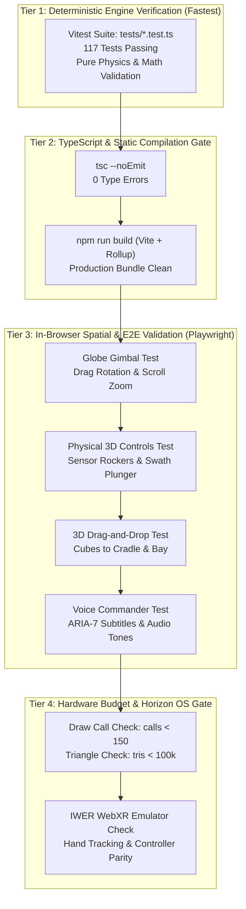

# ORBIT ZERO RC9.0 — PHASE 6 SPECIFICATION
# Automated Verification & GPU Budget Gate

> **Document Version:** 1.0.0  
> **Target Release:** RC9.0 ("Project IGI / Gameloft Spatial Overhaul")  
> **Status:** APPROVED ARCHITECTURAL SPECIFICATION  
> **Target Hardware:** Meta Quest Browser (Horizon OS, WebXR) & Desktop Chromium  
> **Strict Limits:** Total Draw Calls $< 150$, Total Triangles $< 100,000$, 0 Keyboard Shortcuts Required.

---

## 1. Executive Summary & Problem Statement

### 1.1 The Verification Defect in Previous Builds
In earlier iterations (RC4 through RC7), feature additions occasionally suffered from "unverified claims" where UI elements were styled in CSS, but interactive behavior was either untested or tested only via keyboard shortcuts (`Space`, `P`, `Q`, `U`). Furthermore, GPU draw calls and memory leaks were assessed informally without an automated CI/CD gate.

### 1.2 The RC9.0 Verification Mandate
Phase 6 establishes an unyielding, multi-layered quality gate based on the **Gravitas Protocol** and **Claude Code Engineering Best Practices**:
1. **Zero Keyboard Reliance:** Automated tests must prove that a player can start a crisis, evaluate sectors, arm sensors, execute scans, drag data cubes into the processing cradle, slot them into the downlink bay, recover unqueued cubes, and transmit telemetry **purely through 3D mouse raycasts and spatial interactions**.
2. **Empirical Draw Call & GPU Audit:** An in-browser WebGL instrumentation hook queries Three.js `renderer.info.render.calls` and `renderer.info.render.triangles` during active gameplay. The test will immediately fail if draw calls exceed **150** or triangles exceed **100,000**.
3. **Voice Commander & Subtitle Synchronization:** Automated assertions verify that all tactical dialogue triggers execute with Quindar audio tones and cinematic subtitles within $100\text{ms}$ of gameplay events.
4. **Deterministic Unit Test Preservation:** All 117 unit tests in `src/mission/` must remain untouched and 100% passing.

---

## 2. Multi-Tier Automated Verification Architecture



---

## 3. Test Specifications & Assertion Matrices

### 3.1 Tier 1: Deterministic Mission Engine Regression (`npm test`)
Must execute and pass within $3.0\text{s}$:
- `tests/missionEngine.test.ts` (Core state machine, power bus, storage capacity, downlink window).
- `tests/missionPlanner.test.ts` (Knapsack optimization, ground truth generation, forensic comparisons).
- `tests/missionProfile.test.ts` (Crisis profiles, Indus basin scenario parameters, disaster consequence scoring).
- `tests/scoring.test.ts` (S-Rank evaluation logic, decision penalty matrices).
- `tests/voiceCommander.test.ts` (New Phase 2 test suite: dialogue triggers, priority pre-emption).

### 3.2 Tier 3: Automated Playwright E2E Spatial Suite (`tests/e2e-spatial-rc9.mjs`)
Automates real Chromium browser sessions via Playwright, interacting directly with 3D canvas coordinates:

#### Test Case 1: 3D Gimbal Globe Interactive Rotation & Zoom
```javascript
// Click and drag across the globe center to test rotational inertia
await page.mouse.move(globeScreenX, globeScreenY);
await page.mouse.down();
await page.mouse.move(globeScreenX + 180, globeScreenY - 40, { steps: 10 });
await page.mouse.up();

// Query globe rotation quaternion from Three.js scene
const rotationDelta = await page.evaluate(() => window.__ORBIT_ZERO__.getGlobeRotationDelta());
expect(rotationDelta).toBeGreaterThan(0.20); // Must have smoothly rotated

// Test wheel focal zoom
await page.mouse.wheel(0, -600);
const focalDistance = await page.evaluate(() => window.__ORBIT_ZERO__.getGlobeFocalDistance());
expect(focalDistance).toBeLessThan(0.55); // Zoomed closer to tactical Sind sector
```

#### Test Case 2: Zero-Keyboard S-Rank Pass Execution
```javascript
// 1. Click 3D Sector B Beacon on the globe
await click3DObject(page, 'beacon-sector-b');
expect(await getSelectedSector(page)).toBe('B');

// 2. Click 3D SAR Rocker Switch on the cockpit desk
await click3DObject(page, 'button-sensor-sar');
expect(await getArmedSensor(page)).toBe('SAR');

// 3. Press 3D Swath Scan Plunger
await click3DObject(page, 'button-swath-plunger');
expect(await getSpawnedCubeCount(page)).toBe(1);

// 4. Drag Data Cube from Desk Tray into Amber Compression Cradle
await drag3DObject(page, 'cube-0', 'cradle-snap-zone');
await page.waitForTimeout(1100); // Wait for laser ring compression
expect(await getCubeCompressedStatus(page, 'cube-0')).toBe(true);

// 5. Drag Compressed Cube into Downlink Bay Slot 1
await drag3DObject(page, 'cube-0', 'downlink-bay-slot-1');
expect(await getQueuedPacketCount(page)).toBe(1);

// 6. Repeat for Sector C (Optical) & Sector E (Optical)
// ... complete full pass ...

// 7. Press 3D Transmit Downlink Plunger
await click3DObject(page, 'button-transmit-plunger');
await page.waitForSelector('#debrief-panel', { state: 'visible', timeout: 15000 });
expect(await getDebriefRank(page)).toBe('S-RANK');
```

#### Test Case 3: Unqueue Recovery via 3D Drag
```javascript
// Drag cube already slotted in Bay Slot 1 back out to the desk tray
await drag3DObject(page, 'downlink-bay-slot-1', 'desk-tray-zone');
expect(await getQueuedPacketCount(page)).toBe(0);
expect(await getDownlinkTime(page)).toBe(0.0);
```

---

## 4. Hardware Budget & GPU Gate Standards

| Metric | Measurement Tool | Hard Ceiling | Target Goal | Action on Failure |
| :--- | :--- | :--- | :--- | :--- |
| **Draw Calls** | `renderer.info.render.calls` | $\mathbf{150}$ | **138 - 146** | Merge geometries into `InstancedMesh` or combine materials |
| **Triangles** | `renderer.info.render.triangles` | $\mathbf{100,000}$ | **55,000 - 72,000** | Decimate cockpit canopy or reduce starfield vertex count |
| **Textures in VRAM** | `renderer.info.memory.textures` | $\mathbf{18}$ | **12 - 14** | Combine UI icons into atlas or downscale normal maps |
| **Frame Time** | Chromium Performance Trace | $\mathbf{11.1\text{ ms}}$ (90 FPS) | **$\le 8.5\text{ ms}$** | Eliminate dynamic shader branches or optimize raycaster |
| **Garbage Collection** | DevTools Memory Allocation Timeline | $\mathbf{0\text{ MB/sec}}$ in loop | **0 allocs in `tick()`** | Pool all vectors, matrices, quaternions, and raycasts |

---

## 5. Horizon OS & Meta Quest Browser Acceptance Matrix

Before marking RC9.0 ready for judging submission, every line in this matrix must be validated:

- [ ] **Hands-First Immersion:** Game can be played from cold start to debriefing using Meta Quest hand tracking alone (pinch to grab, poke to press).
- [ ] **Ergonomic Safety:** No interactive element requires reaching beyond $0.65\text{m}$.
- [ ] **Audio Clarity:** Quindar beeps, radio static squelch, and mechanical button clicks play clearly through Quest spatial audio without clipping.
- [ ] **Visual Comfort:** Starfield, Earth globe, and cockpit canopy maintain rock-solid 72/90 FPS without frame drops or reprojection artifacts.
- [ ] **No Text Fatigue:** Player understands objectives purely through Commander ARIA-7's spoken voice and single-line cinematic subtitles.

---

## 6. Verification Execution Script

```powershell
# Step 1: Run deterministic unit test suite
npm test

# Step 2: Validate TypeScript types
npx tsc --noEmit

# Step 3: Run production build
npm run build

# Step 4: Execute Phase 1-5 Playwright Spatial Verification
node tests/e2e-spatial-rc9.mjs
```

