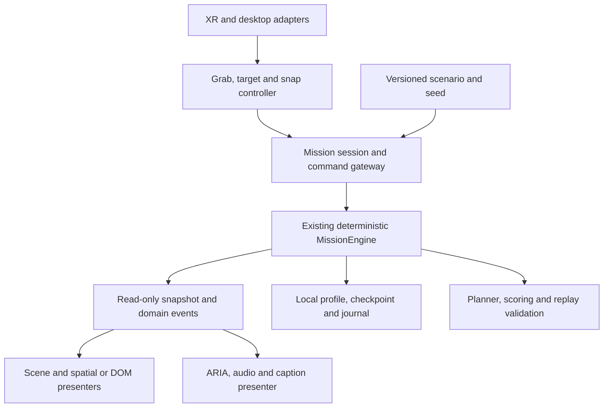

# ORBIT ZERO: THE LAST DOWNLINK — Engineering Recommendations

## 1. Executive Summary

**Audit completed, 6 November 2026, against workspace revision `50a8c5b`.** Labels below distinguish **verified implementation**, **evidence gaps**, and **recommendations**; implemented does not mean release-ready.

Preserve the humanitarian intelligence-triage premise, tactile evidence cubes, seated cockpit, deterministic mission engine, and explicit uncertainty. The memorable proposition is deciding **which evidence deserves the last downlink**, not operating an elaborate dashboard. The current project implements a substantial playable loop, but premium credibility is undermined by divergent interaction paths, unreliable training qualification, generated-scenario inconsistencies, and unsupported hardware-readiness claims.

**First fix input/state correctness and establish physical Quest evidence.** Then unify feedback and improve meaningful campaign decisions. Do not rewrite the engine, add more decorative effects, introduce multiplayer, or build backend infrastructure to compensate for unfinished gameplay.

The finding register contains **2 P0, 9 P1, 8 P2, and 2 P3 items**. P0 denotes a release blocker, including an unclosed hardware-verification gate—not a claim that a headset failure was observed.

## 2. Verified Current Project State

| Area | Verified state |
|---|---|
| Stack | Lockfile: IWSDK **1.0.1**, UIKitML **0.1.8**, Three.js alias **super-three 0.181.0**, TypeScript **5.9.3**, Vite **7.3.7**, Vitest **3.2.7**, Playwright **1.64.1**, IWER **2.7.0**. Historical documentation describes different versions. |
| XR/physics | `iwsdk.config.json` requests VR, `local-floor`, and hand tracking. Physics and locomotion are disabled. Rapier/Havok are dependency-tree entries, not evidence of active game physics. |
| Product | Academy, Fireline, Monsoon, and Aftershock configurations exist; additional legacy scenario IDs, daily rotation, procedural passes, preferences, mastery, replay, and ARIA assistance also exist. |
| Screens | DOM landing/selection/advisory; spatial briefing, telemetry/inspection, and debrief panels; desktop campaign/settings/tutorial/HUD overlays. Mission results include success, partial success, and failure diagnostics. |
| Data/services | Local-storage profile; no observed accounts, server API, database, multiplayer, cloud saves, or analytics transport. ARIA's `AgenticCoPilot` is rule/planner-driven, **not an LLM**. |
| Fresh verification | `npm run typecheck` passed. Five selected unit-test files passed **97 tests**: engine, planner, procedural crisis, profile, and co-pilot. This was not the complete suite. |

Existing `artifacts/release-audit/` screenshots/report and profiling JSON provide historical desktop/IWER evidence, not current-build or physical-headset certification. Full build/E2E execution was deliberately avoided because existing scripts write build/release artifacts; no dependencies were installed.

## 3. Existing Architecture Map

- `src/index.ts:initOrbitZeroGame` creates the IWSDK world and registers `MissionControlSystem`; `LandingController` owns a separate Three.js landing renderer/UI/audio lifecycle.
- `src/mission/missionEngine.ts:MissionEngine` owns simulation state, resource accounting, acquisition, processing, queueing, timed transmission, and action journals. Configuration, planning, scoring, and tutorial logic are separate modules.
- `src/systems/missionControlSystem.ts` is approximately **5,837 lines**: ECS bindings, input interpretation, cube manipulation, simulation orchestration, panel updates, effects, settings, persistence, and testing globals.
- `src/systems/desktopControls.ts:DesktopControlsManager` adds approximately **3,160 lines**, including a second drag/drop interpretation and substantial DOM UI generation.
- `src/scene-assets/` builds procedural objects; `src/assets.ts` and `public/scenes/main.iwsdk.scene.json` connect assets/entities; `public/ui/*.uikitml` defines spatial panels.
- Audio/voice/profile systems are separate, but coordinated through the large runtime system and browser globals.

The valuable boundary is **pure simulation versus platform presentation**. No direct relative-TypeScript-import cycle was found by a lightweight dependency scan; behavioral coupling is the larger problem. `getState()` copies packet records shallowly, leaving nested provenance collections shared.

## 4. Gameplay and Campaign Review

**Verified loop:** select sector/sensor → scan → inspect cube → process or discard → stage/reorder evidence → commit downlink → evaluate transmitted evidence. Three physical cube slots coexist with a nine-unit storage budget; compression frees storage, not cube slots. Power costs and transmission durations make some planning consequential.

| Operation | Distinct implementation | Design assessment/recommendation |
|---|---|---|
| **OP 00 Academy** | Tutorial state machine and single-target scoring override. | Preserve short rehearsal; a grab can satisfy inspection, and scoring qualifies any non-unverified transmission without proving compression or all gestures. |
| **OP 01 Fireline** | Thermal hotspots through smoke; optical structural inspection; cloud/thermal limitations and non-fire heat decoys. | Strongest modality contrast. Require players to justify an actionable hotspot versus an irrelevant thermal anomaly; avoid exposing the complete solution before discovery. |
| **OP 02 Monsoon Shield** | Landing maps this operation to `STANDARD_INDUS_PASS`: SAR for clouded sectors, optical for the clear bridge. Separate `MONSOON_SUPERCELL_PASS` clouds that bridge and limits certainty. | Preserve the distinction; test best-achievable partial outcomes in Supercell rather than incorrectly labeling the main operation unwinnable. Compression must not resolve metallic ambiguity. |
| **OP 03 Aftershock** | Optical damage assessment, thermal substation evidence, and a scripted processing upgrade for probable SAR observations. | Different disaster theme, but the same acquisition/staging sequence. Separate surface-change evidence from temperature evidence; add a justified comparison decision rather than magical processing. |

Preparation is not governed by an advancing orbital-contact deadline: `commitDownlink()` starts the transmission clock. Procedural threat descriptions/severity do not themselves simulate evolving emergencies. Campaign outcomes primarily become debrief text, not continuing world consequences.

**Recommendation:** retain deliberate seated planning, but introduce one mission-specific uncertainty or priority conflict at a time. Authored route/shelter consequences, alternative valid solutions, and constrained rescans offer more replay value than cosmetic seed variation. Guidance should explain the next decision; Expert mode should not silently become an optimal-plan executor.

## 5. Frontend, UI/UX and Art Direction Review

**Verified inconsistency:** landing CSS, desktop inline styles, UIKitML, and cube canvases independently encode hierarchy/status. Some metadata is 10px. Landing buttons have focus-visible styles; desktop campaign containers need a keyboard audit. Responsive landing rules do not establish cockpit-overlay usability.

`src/systems/missionControlSystem.ts:updateCubeTelemetryCanvas()` draws generic water/bridge imagery across evidence, labeling unverified packets “CLOUD BLOCKED / OPTICAL SCATTER” regardless of modality. Repeated banners, scientific metadata, ARIA overlays, and cube labels compete for attention.

**Recommended visual system:** “Tactile Orbital Instrumentation.” Use restrained dark hardware, neutral readable text, one interaction accent, and separately labeled uncertainty/warning states. Prioritize **objective → actionable evidence → resource constraint → next action**. Keep detailed caveats in inspection, not every persistent surface. Success/failure screens should show evidence delivered, unmet requests, consequence, and one retry lesson—not another telemetry wall.

Earth should establish place and scale; the cube should communicate provenance; ARIA should focus attention. Align landing promise with cockpit fidelity rather than adding bloom, particles, panels, or militarized ornament. Validate typography in angular size and actual seated optics, not CSS pixels alone.

## 6. 3D, WebXR and Interaction Review

**Verified:** procedural cockpit/cupola, textured Earth, satellite assets, holographic cube contents, emissive instrumentation, transparent overlays, and animated ARIA exist. Static mesh merging already exists; preserve dynamic named objects when optimizing. Lighting uses ambient/directional and local instrument lights; no measured shadow/rendering-quality guarantee follows from their presence.

Genuine IWSDK interaction components coexist with a custom hand sampler and drag system. `sampleLiveXRHandState()` favors IWER's remote hand-state API; the physical branch assumes left/right controller indices, returns `connected: true` without validating current joint visibility, and `updateXRHandInteractions()` skips null samples without necessarily releasing held objects. Three.js assigns input slots by connection order. This is a **verified contract defect; its physical symptom remains untested**. Late-created Three.js hand groups can populate on later frames—permanent empty joints are not established.

Custom grabs can suppress/force-release SDK grabs, and two hands lack a clear exclusive cube owner. Desktop and XR also disagree on drop arbitration and some station coordinates. Broad magnetic envelopes overlap. Seated/tabletop/recenter settings cannot be certified while interaction anchors remain independent world-space constants.

**Recommendation:** one canonical input-source adapter, one exclusive grab lifecycle, and station-local snap anchors with preview, hysteresis, and explicit release. Test absent hands, right-first connection, partial joints, occlusion, reacquisition, rejected drops, and exit/re-entry. IWER gestures are useful integration evidence; they do not reproduce real tracking noise, comfort, depth readability, or fatigue.

## 7. Backend and Data Architecture Decision

**Choose a local-first, self-contained single-player game.** Static HTTPS hosting plus versioned local saves is sufficient for the verified product.

Keep preferences and mastery in local storage with schema validation, migration, recoverable write errors, and export/import. Introduce an active-mission checkpoint only after reset/replay semantics are stable; include scenario version/seed and journal or validated state. Use IndexedDB only if save/replay volume justifies it.

Do not build authentication, databases, matchmaking, multiplayer, remote configuration, or cloud saves now. Optional opt-in analytics should answer a defined onboarding/balance question. Cloud saves become valuable only with demonstrated cross-device demand. Local scores/debug commands are untrusted if competitive leaderboards are ever introduced; obfuscating the client would not solve that trust boundary.

## 8. Scientific Authenticity Review

**Implemented principles:** optical cloud obstruction, thermal cloud/smoke distinctions, SAR surface backscatter and geometric ambiguity, and explicit scripted uncertainty. These are authored observations—not image acquisition or remote-sensing inference.

`missionConfig.ts` supplies confidence percentages, SNR, resolution, temperature narratives, and sensor outcomes. Those values are **illustrative**, not calibrated probabilities or measurements. Aftershock processing explicitly performs a heuristic confidence upgrade; no measured pre/post image comparison exists. Compression is a fixed resource/payload transformation, not an implemented scientific codec.

A concrete overclaim occurs when processed SAR satisfies Aftershock REQ 3 and the success consequence nevertheless asserts a **740 K transformer anomaly**. Evidence must support the conclusion's modality and scope.

Transmission arithmetic is payload / throughput with **zero default overhead**. Source comments/UI use **MB and MB/s**, despite ambiguous `Mb`/`Mbps` identifiers: do not silently reinterpret these as bits or a real radio link budget. Procedural briefing calls an abstract buffer “9 MB”; other UI uses `STR` with an illustrative 18 MB/STR mapping. Power is labeled Wh without time-integrated consumption, charging, or modeled orbit/contact geometry. Standardize these abstractions before adding realism.

## 9. Performance and Reliability Review

Historical `artifacts/profile/xr-state-profile.json` reports **176 median calls, 182,940 triangles, one render invocation/frame, and 52 transparent renderables** in emulated XR. Other historical artifacts report different scenes/counts. None establishes current physical Quest CPU/GPU frame time. `tests/e2e-runtime.mjs` still gates unrelated post-XR counts at 145 calls/100,000 triangles; arbitrary budgets are not device performance evidence.

Measure sustained headset frame intervals, missed frames, CPU/GPU timing where available, load time, and memory across operations/restarts. At 72 Hz, the frame interval is approximately **13.9 ms**; renderer counters diagnose workload, not compliance. Profile transparency/overdraw, canvas texture uploads, synchronous planning, snapshot allocation, material/light cost, and full `syncAll()` updates before optimizing.

Local `public/assets/models/incoming/` contains **47.8 MiB** of ignored source material. Vite's public-directory copying does not obey `.gitignore`; verify the release manifest. Root-relative landing texture URLs conflict with relative-base deployment. Existing licensing audits do not establish the provenance of every newer/generated asset. Launch errors, global listeners, and shared material state also require targeted reliability work; generalized “no leaks” claims are unsupported.

## 10. Testing and QA Gaps

The fresh **97 passing unit tests** establish selected deterministic behavior, not complete gameplay validity. The full balance harness writes release artifacts and was not run. Existing E2E scripts exercise desktop controls, IWER pointing/pinching, placement, transmission, and outcomes; some helpers fall back to `clickPanel()` or use debug commands for setup/progression.

The current release audit does include gesture traversal for its hands stage; do not dismiss it as entirely direct-action testing. However, its IWER remote branch and mono emulation do not validate the physical sampler, stereo presentation, or hands-only journey from browser landing through results. Reports generally lack build/content hashes, weakening reproducibility.

Add invariant/property tests, input-contract integration tests, no-fallback golden-path E2E, generated-seed replay tests, profile reload tests, loading-failure tests, and repeated-session soak tests. Physical Quest 3/3S acceptance remains a separate required tier. Deployment, dependency vulnerability status, real sensor validity, headset audio, and long-session comfort were not independently certified.

## 11. Prioritized Weak Points

Effort: **S** localized, **M** subsystem, **L** coordinated work. Risk: **low/medium/high** migration risk. Acceptance is observable, not “looks polished.” Paths are repository-relative.

| ID | Priority | Weakness / evidence | Recommendation → acceptance; effort/risk |
|---|---|---|---|
| F01 | P0 | Physical hand identity/visibility/loss contract is unsafe (`src/systems/missionControlSystem.ts:2584,3237`). | Use handed active sources/frame poses; recover on loss → no stale grab or wrong-hand action in contract tests and Quest; M/high. |
| F02 | P0 | No physical headset performance/ergonomic release evidence. | Require recorded Quest sessions and sustained frame-time/comfort checks → all four operations hands-only on declared devices; L/low. |
| F03 | P1 | Competing SDK/custom grabs; no exclusive cube ownership (`src/systems/missionControlSystem.ts:resolve3DTargetForHand`, `syncCubeTransforms`). | One owner/authority; exclude hidden/ineligible targets → simultaneous grabs cannot duplicate/teleport cubes; M/high. |
| F04 | P1 | Duplicate world anchors/drop policies (`desktopControls.ts:79–87,632`; runtime station constants/`handleCubeReleased`). | Shared station-local nearest-target resolution and calibration → equivalent drops behave identically after recenter/tabletop changes; M/high. |
| F05 | P1 | Grab satisfies inspection; Academy's scoring override asserts full qualification without observing gestures/compression (`src/mission/scoring.ts:182–239`). | Require distinct gesture evidence and valid training packet → grab/raw unrelated transmission cannot certify training; M/medium. |
| F06 | P1 | Generated config is absent from planner/benchmark/cache and `replayMission()` inputs. | Carry immutable scenario definition/version/seed everywhere → accepted plan, score, and replay agree across a seed corpus; M/high. |
| F07 | P1 | SAR-only substation evidence yields thermal consequence (`missionConfig.ts:AFTERSHOCK_REQUESTS.REQ_3`). | Derive consequences from evidence capability → SAR never asserts measured temperature; S/low. |
| F08 | P1 | XR launch rejection is swallowed; landing assets use root URLs (`index.ts:56–61`; `landingScene.ts`). | Recoverable launch/loader and consistent asset base → denied XR and subpath hosting preserve a usable menu/game; M/medium. |
| F09 | P1 | E2E fallbacks mask interface failures; budgets/reports are not reproducible release gates (`e2e-runtime.mjs:84–96,196–199`). | Separate setup hooks from no-fallback journeys; stamp build/device/settings → unreachable controls fail the test; M/low. |
| F10 | P1 | Spatial `AudioCaption` is a cue summary; actual ARIA speech subtitles live in DOM (`voiceCommander.ts:ensureSubtitleBar`; `syncSettings`). | One caption feed to DOM and spatial panel → all spoken instructions available in silent immersive play; M/medium. |
| F11 | P1 | Profile reload omits Academy; any Fireline/Standard debrief marks tutorial complete (`missionProfile.ts:loadMissionProfile`, `recordMissionMastery`). | Persist actual training qualification with versioned migration → reload retains Academy and failed campaign cannot skip training; S/medium. |
| F12 | P2 | All bay waveguides share one material, then receive per-slot mutations (`orbitalConsole.scene-asset.ts:817–834`; `syncAll`). | Separate independently styled slot materials → mixed empty/queued/overflow slots remain visually distinct; S/low. |
| F13 | P2 | Static preparation/threat metadata and repeatable recipe limit mission depth. | Add authored information conflicts and response consequences → players make different justified plans, not just execute prompts; L/medium. |
| F14 | P2 | `9 MB` briefing disagrees with abstract storage; confidence/physics labels imply excess precision. | Explicit units and illustrative-quality labels → UI, calculations, caveats, and debrief agree; S/low. |
| F15 | P2 | Independent styling, tiny metadata, generic cube diagrams, weak focus treatment. | Shared presentation tokens and evidence-specific inspection → readable, keyboard-operable screens and consistent labeled states; M/medium. |
| F16 | P2 | Hot-path planning/snapshots/UI uploads and overdraw lack causal profiling. | Measure then optimize dirty updates/resources, preserving existing merging → sustained device traces improve without interaction regression; M/medium. |
| F17 | P2 | Public source assets can ship; attribution audits are stale. | Curated runtime asset manifest plus exact provenance → deployment excludes incoming sources and every shipped asset is traceable; S/low. |
| F18 | P2 | Landing key listener and speech voice callback outlive visible UI (`landingUI.ts:442,499`; `voiceCommander.ts:529`). | Explicit session ownership/unsubscribe/dispose → repeated transitions plateau in listeners, memory, and renderer resources; M/medium. |
| F19 | P2 | Planner delegation can displace player judgment (`agenticCoPilot.ts`). | Preview one bounded action, revalidate it, disclose assistance → Expert mastery cannot be earned by undisclosed autopilot; S/medium. |
| F20 | P3 | Browser speech voices and synthetic cues vary in delivery quality. | Optional authored radio lines/mix after correctness → intelligible, non-overlapping speech with tested captions; M/low. |
| F21 | P3 | Crisis storytelling mostly resides in text/effects rather than persistent outcomes. | Optional restrained response-status/environment changes → consequences memorable without extra interaction clutter or frame-time loss; M/low. |

## 12. Recommended Target Architecture

| Existing → target | Why / migration risk / status |
|---|---|
| Bootstrap/globals → application session owner | Own landing/world launch, failure recovery, XR enter/exit, and disposal. Medium risk; **essential**. |
| Multiple input/drop paths → adapters plus one interaction controller | Normalize poses/intents; own `idle → hover → held → preview → released/recovered`. High risk; **essential**, migrate one flow at a time. |
| Runtime orchestrator → thin ECS bridge and command gateway | Route actions to existing engine; keep transient hand ownership outside simulation. High risk; **essential incremental extraction**, not a rewrite. |
| Static-ID lookups → versioned scenario context | Keep planner/scoring/replay deterministic and consistent. Medium risk; **essential**. |
| `syncAll()`/inline UI → read-only view models and presenters | Separate rendering, caption/audio events, and dirty updates; protect nested state. Medium risk; **essential for touched flows**. |
| Ad hoc profile writes → local persistence adapter | Validate/migrate profile; add checkpoint only when lifecycle stable. Low–medium risk; profile repair **essential**, checkpoint **optional**. |
| Independent resource creation → owned asset lifetime | Separate shared immutable assets from per-object dynamic materials; dispose on session teardown. Medium risk; **essential**. |

Mission flow remains **briefing → operations → downlink → debrief → retry/next**; pause and XR visibility are explicit session conditions. Rendering never changes evidence validity. Accepted commands update the engine; presenters consume snapshots/events; persistence records stable outcomes. Keep configuration authored and testable. No event bus, ECS replacement, or generic service framework is needed.

## 13. Implementation Roadmap

1. **Release correctness foundation:** F01, F03–F07, F11–F12; establish invariant and input-contract tests first. Depends on agreeing canonical source/ownership/scenario contracts. Highest migration risk; compare desktop and emulated journeys after each slice.
2. **Reliable player journey:** F04, F08–F10, F15, F18–F19. Complete launch, settings, calibration, captions, training, failure recovery, and debrief without debug shortcuts. Depends on stage 1.
3. **Device qualification and performance:** start F02 measurement immediately; close it after stages 1–2. Address F16–F17 using measured contributors and a curated deployment. Never postpone hardware discovery until final polish.
4. **Campaign/product polish:** F13–F14, then optional F20–F21. Playtest alternatives, uncertainty, retry motivation, radio mix, and consequence readability. Depends on a stable, measured loop; do not add another campaign first.

## 14. Definition of Done

- Typecheck, unit/invariant tests, generated-seed plan/replay tests, and no-fallback desktop/IWER journeys pass on an identified build.
- Physical Quest records prove four-operation completion, loss recovery, seated reach, stereo text, silent/captioned play, and XR exit/re-entry; device/browser/refresh settings are recorded.
- Sustained frame-time and restart-soak traces meet the selected refresh rate without unacceptable missed frames or resource growth.
- Reload retains legitimate mastery; denied XR, unavailable storage, and failed assets produce recoverable states.
- Debrief statements trace to transmitted evidence; illustrative science and abstract units are consistently labeled.
- Production HTTPS/subpath hosting loads the curated assets; attribution/dependency review is complete. No unsupported “Quest-ready,” “scientifically calibrated,” or “hands-only” claim remains.

## 15. Final Technical Recommendations

Protect the game's identity: **humanitarian decisions made through tactile evidence under constrained contact**. Repair the thin contracts around the working engine before expanding it. Build trustworthy hands, coherent uncertainty, meaningful consequences, and measurable performance next; avoid infrastructure and spectacle that do not improve those qualities.

**Audit scope verification:** only `recommendations.md` is intended to change. Existing application source, tests, configurations, lockfiles, and pre-existing release artifacts are checked against audit-start fingerprints; physical hardware and fresh production deployment remain unverified.
